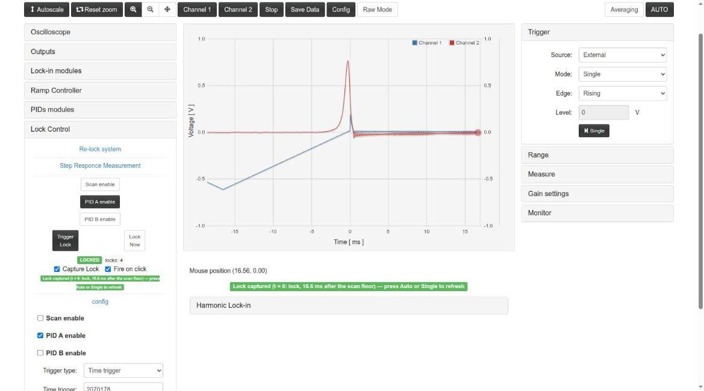

# Red Pitaya Lock-in+PID Application with HARMONIC modulation with TWO demodulation channels

This project is based in [lock-in+PID Harmonic](https://github.com/marceluda/rp_lock-in_pid_h).

It is an application for the [Red Pitaya STEMlab 125-14](https://www.redpitaya.com/) board (RP): a set of
instruments built in the FPGA (oscilloscope, **two harmonic lock-in amplifiers**, two PIDs, ramp generator and
automatic lock control) to measure a system with modulation techniques and stabilize it with a feedback loop,
controlled from a web page or remotely over HTTP. One modulation generator gives the reference added to the
outputs and two pairs of demodulation references with independent phases, so two signals (or the same signal at
two phases) are demodulated at the same time.

Video from lock-in+PID Harmonic version:

[](http://www.youtube.com/watch?v=330eYE75MYQ "Fast demosatration of usage")




## Version 2.4.x (Ecosystem 2.0)

Current version: **2.4.6** (branch `devel2.0`).

This version is **based on the 0.4.x series (v0.4.2), with the FPGA design built in Vivado 2020.1**,
using the project structure of [RedPitaya-FPGA](https://github.com/RedPitaya/RedPitaya-FPGA)
(project `v0.94`, model `Z10`). It is intended for the Red Pitaya **Ecosystem 2.0**
(e.g. `RedPitaya_OS_2.04`; tested on 2.04-35). The 0.4.x series (branch `master`, FPGA with Vivado 2015.2) is the
version for the 0.9x / 1.0 ecosystems.

- v2.4.3: the port of [rp_lock-in_pid_h](https://github.com/marceluda/rp_lock-in_pid_h) v2.3.10-2.3.11 (FPGA in
  Vivado 2020.1, oscilloscope of the Ecosystem 2.0 with time ranges up to ~68 s, streaming and UI fixes) plus the
  exact bus reads of its v2.3.17, keeping the two lock-ins; streaming register offsets generated from `c/lock.txt`;
  only the App itself is packaged.
- v2.4.4: the changes of `rp_lock-in_pid_h` v2.3.12-2.3.17: **lock sequence in the FPGA** (`lock_control` 0x18
  command + configuration, read-only `lock_status` 0x1C), **Capture Lock** and **Fire on click**, Time / Level
  trigger fields with units, 32-bit time trigger (34.36 s), Config → load with the right time window, and the
  **HTTP remote control on Ecosystem 2.0** with `control_finn.py` adapted to the two lock-ins
  (`set_phase(val, line='A'|'B')`, `set_signal()`, `set_gain()`, `set_lpf()`, `get_XY(F=True)` → X, Y, X2, Y2).
- v2.4.5: the minor fixes of `rp_lock-in_pid_h` v2.3.18 (same FPGA): lock trigger registers written from Python
  shown and kept by the page, Single mode keeps a slow poll, Config → load without read-only keys, X+ up to 68.7 s,
  higher priority of the streaming reader, `lock_from_registers.py --time` clamped, `example_usage.py` Lock cell.
- Tested on the board against a simulated peak: locks with time, level and immediate trigger, both lock-ins,
  scope, bus reads, remote control and streaming ([doc/App.md](doc/App.md#lock-control-auto-lock)).
- See the [CHANGELOG](CHANGELOG.md).

**Register map.** The lock module has 102 registers; from `0x054` on the addresses are shifted with respect to
`rp_lock-in_pid_h` (`signal2_sw`, `signal2_i`, `gen_mod_phase_A/_B`). Use register names, not offsets:
[doc/FPGA.md](doc/FPGA.md).


## Features

- **TWO** lock-in amplifiers (A: X, Y of `signal_i`; B: X2, Y2 of `signal2_i`)
  - in-phase and quadrature demodulation
  - independent phase, input, low-pass filter (1st/2nd order, 131 µs .. 4.3 s) and gain for each lock-in
- Harmonic modulation from 3 Hz to 49.6 kHz, added to the outputs
- Two PID filters, for loop back stabilization
- Ramp/Scan controller for response analysis
- Lock control for automatic scan-stop / PID start (time, level or immediate trigger, run by the FPGA)
- Two-channel oscilloscope on any internal signal, triggered by internal events (scan floor, lock, ...)
- Streaming system for continued acquisition of two channels
- Remote control through HTTP API

**More decimaion values**

| dec    | max oscilloscope lenght |
|--------|-------------------------|
|      1 |             0.131072 ms |
|      8 |             1.048576 ms |
|     64 |             8.388608 ms |
|    128 |            16.777216 ms |
|    256 |            33.554432 ms |
|    512 |            67.108864 ms |
|   1024 |           134.217728 ms |
|   8192 |           1.073741824 s |
|  65536 |           8.589934592 s |
| 524288 |          68.719476736 s |


## Documentation

| Document | Contents |
|---|---|
| [doc/App.md](doc/App.md) | Instruments and technical data; differences with `lock_in+pid_harmonic` |
| [doc/Usage.md](doc/Usage.md) | Web interface and procedures (scan, lock-ins, lock), with screenshots |
| [doc/Structure.md](doc/Structure.md) | Web page ↔ server ↔ FPGA, block diagrams |
| [doc/FPGA.md](doc/FPGA.md) | Register map |
| [doc/Remote.md](doc/Remote.md) | Remote control over HTTP, Python examples |
| [doc/Devel.md](doc/Devel.md) | Building, modifying and testing |
| [CHANGELOG.md](CHANGELOG.md) | Changes by version |

The concepts of the instruments are also explained in the documentation of the original App:
https://marceluda.github.io/rp_lock-in_pid/


## Installation

If you have a RP board you can install the **TWO Lock-in+PID** application by copying the
`lock_in+pid_harmonic2` folder (that comes with the tar/zip package) to the `/opt/redpitaya/www/apps` folder
(inside the RP).

The packages are built in `archive/` (`lock_in+pid_harmonic2-<version>-<build>-devbuild.{zip,tar.gz}`).
UnZip / UnTar the package and execute from terminal:

```bash
./upload_app.sh rp-XXXXXX.local
```

Replace `rp-XXXXXX.local` by your RP localname or IP address. Also, you can use your own SSH client and
upload the `lock_in+pid_harmonic2` folder to the RedPitaya folder `/opt/redpitaya/www/apps` (file system in
read-write mode, `fpga.sh` executable). Then open `http://rp-XXXXXX.local/lock_in+pid_harmonic2/`.

For more information about installing procedure, refer to:
https://marceluda.github.io/rp_lock-in_pid/TheApp/install/ and [doc/Devel.md](doc/Devel.md#installing-on-the-board).


## Building

To build or modify the App you need a linux development environment with:
  - Vivado 2020.1 (FPGA and `bootgen`), in `/tools/Xilinx/Vivado/2020.1` (`lock_in+pid_harmonic2/fpga/Makefile`
    loads it by itself; override with `VIVADO_SETTINGS=...`)
  - gcc-linaro-4.9-2015.02-3-x86_64_arm-linux-gnueabihf (installed on `/opt/linaro/`)
  - (the 0.4.x series, branch `master`, used Vivado 2015.2; `settings.sh` still sources it if present)

The App was based on code from project:
https://github.com/RedPitaya/RedPitaya/tree/release-v0.95/apps-free/scope

Run on terminal:

```bash
source settings.sh
LANG=C make          # controller, c/ tools, FPGA (if changed) and packages in archive/
```

Parts (from the root folder):

```bash
make -C lock_in+pid_harmonic2 app        # C controller + c/ tools (cross compiled)
make -C lock_in+pid_harmonic2 c_tools    # only the c/ tools (lock, osc, streaming)
make -C lock_in+pid_harmonic2 fpga       # FPGA with Vivado 2020.1 (red_pitaya.bit, fpga.bit.bin)
make clean                               # clean all (also: clean_app, clean_fpga in lock_in+pid_harmonic2)
make -C lock_in+pid_harmonic2 upload RPIP=rp-XXXXXX.local        # whole App to a board
make -C lock_in+pid_harmonic2 upload_html RPIP=rp-XXXXXX.local   # only index.html, js, css
```

After an upload, stop and start the App (or open it from the menu) so that the new controller and FPGA are
loaded. Requirements, all the targets, tests and details: [doc/Devel.md](doc/Devel.md).


## License and citation

GPL-3.0 (see [LICENSE](LICENSE)). If you use this software, please cite it (see [CITATION.cff](CITATION.cff)):
M. A. Luda, doi [10.1063/1.5080345](https://doi.org/10.1063/1.5080345).
