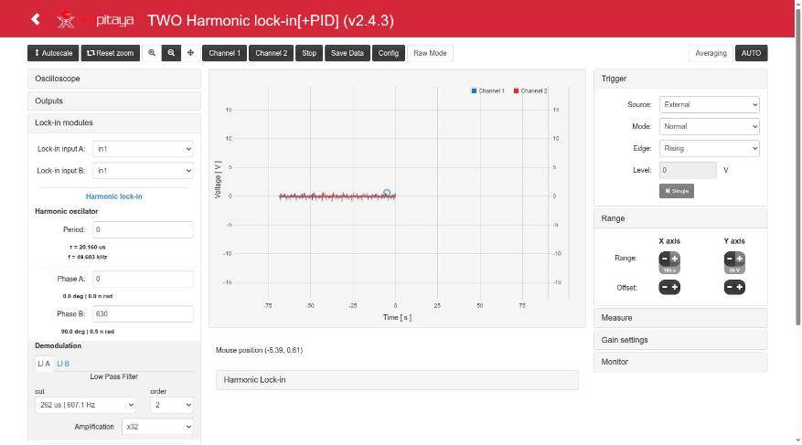

# The App: instruments and specifications

`lock_in+pid_harmonic2` ("TWO Harmonic Lock-in+PID") **v2.4.4** for the Red Pitaya STEMlab 125-14,
Ecosystem 2.0 (tested on RedPitaya_OS 2.04-35). Branch `devel2.0`.

This App is [Lock-in+PID Harmonic](https://github.com/marceluda/rp_lock-in_pid_h) (`lock_in+pid_harmonic`
v2.3.17) with **two lock-in amplifiers instead of one**: a single modulation generator gives the reference
`cos_ref` (the one added to the outputs) and two pairs of demodulation references with independent phases,
`cos_A`/`sin_A` and `cos_B`/`sin_B`, which demodulate two independently selected inputs (`signal_i` → X, Y and
`signal2_i` → X2, Y2). The 2f/3f demodulation (F1, F2, F3) of `_h` does not exist in this App.

This page describes what the App contains and its technical data. How to use it from the web page is in
[Usage.md](Usage.md); how the parts are connected in [Structure.md](Structure.md); the registers in
[FPGA.md](FPGA.md).

- [The instruments](#the-instruments)
- [What is different from lock_in+pid_harmonic](#what-is-different-from-lock_inpid_harmonic)
- [General data](#general-data)
- [Oscilloscope](#oscilloscope)
- [Inputs and outputs](#inputs-and-outputs)
- [Modulation generator](#modulation-generator)
- [The two lock-in amplifiers](#the-two-lock-in-amplifiers)
- [Ramp generator (scan)](#ramp-generator-scan)
- [Error signal and PIDs](#error-signal-and-pids)
- [Lock control (auto-lock)](#lock-control-auto-lock)
- [Re-lock and step response](#re-lock-and-step-response)
- [Monitor](#monitor)
- [Streaming](#streaming)
- [Remote control](#remote-control)

## The instruments

Like the [Lock-in+PID](https://marceluda.github.io/rp_lock-in_pid/TheApp/instruments/instruments_01_intro/)
App it comes from, this App is a set of "instruments" built inside the FPGA. They are not isolated
blocks: they are a logical division of one circuit (`lock.v`), whose signals can be routed to each other
with selectors, so that a measurement or a feedback loop is configured instead of wired.

| Instrument | What it does | Main registers |
|---|---|---|
| **Oscilloscope** | Two channels, any of 25 internal signals, 16384 samples, time spans from 131 µs to 68.7 s, external trigger from internal events | scope block 0x40100000, `oscA_sw`, `oscB_sw`, `trig_sw` |
| **Inputs / outputs** | Routing of 16 signals to the fast outputs OUT1/OUT2 (4 of them are 0 in this App), with optional modulation (`cos_ref`) added | `out1_sw`, `out2_sw`, `mod_out1`, `mod_out2` |
| **Modulation generator** | Harmonic local oscillator `gen_mod_h2`: `cos_ref` and two quadrature pairs `cos_A`/`sin_A`, `cos_B`/`sin_B` with independent phases, 3.03 Hz – 49.6 kHz | `gen_mod_hp`, `gen_mod_phase_A`, `gen_mod_phase_B` |
| **Lock-in A** | Demodulation of `signal_i` with `cos_A`/`sin_A` → X, Y (and Xo, Yo after the gain), 1st/2nd order low-pass filter | `signal_sw`, `lpf_F0`, `sg_amp0` |
| **Lock-in B** | Demodulation of `signal2_i` with `cos_B`/`sin_B` → X2, Y2 (X2o, Y2o) | `signal2_sw`, `lpf_F1`, `sg_amp1` |
| **Ramp generator** | Triangle or sawtooth scan on two outputs with a fixed ratio (A and B) | `ramp_*` |
| **Two PIDs** | PID A and PID B, wide range of gains and time constants, integrator saturation, freeze and reset | `pidA_*`, `pidB_*`, `error_sw`, `error_offset` |
| **Lock control** | Automatic transition from scan (open loop) to lock (closed loop) at a time, a level or immediately, executed by the FPGA | `lock_control`, `lock_status`, `lock_trig_*` |
| **Re-lock / step response** | Out-of-lock detection; a step added to the control signals to measure the loop response | `rl_*`, `sf_*` |
| **Monitor** | Mean and standard deviation of the error over ~1 s | `error_mean`, `error_std` |
| **Streaming** | Continuous transfer of the two scope channels to a computer over TCP | `stream_*` |
| **Remote control** | HTTP API to read and write all the registers, make scope acquisitions and run the lock (Python client `control_finn.py`, with both lock-ins) | `/lock`, `/osc`, `/data` |

The two control signals of the App are:

```
ctrl_A = PID A out + Ramp A (+ jump A)     → usually sent to OUT1
ctrl_B = PID B out + Ramp B (+ jump B)     → usually sent to OUT2
```

(`lock.v` l. 286-290.)

## What is different from lock_in+pid_harmonic

Checked by comparing the trees (`devel2.0`: `_h2` `0980cf7` against `_h` `5bf27fc`, with the App names
substituted). Outside the items of the table the RTL (top, scope, filters, PID, ramp, `lock_ctrl.v`), the C
controller, the `c/` tools and the web page are the same; most differences are only names.

| Item | `lock_in+pid_harmonic` 2.3.17 | `lock_in+pid_harmonic2` 2.4.4 | Source |
|---|---|---|---|
| Modulation generator | `gen_mod_h.v`: `sin_ref`, `cos_ref`, `cos_1f`, `cos_2f`, `cos_3f` (one phase) | **`gen_mod_h2.v`**: `cos_ref`, `cos_A`/`sin_A` (phase A), `cos_B`/`sin_B` (phase B). Same tables and period (2520 points) | `lock.v` l. 598-615, `lock/gen_mod_h2.v` |
| Signals that are 0 | — | `sin_ref`, `cos_1f`, `cos_2f`, `cos_3f`, `F3o` (shown as disabled "(n/a)" options in the page) | `lock.v` l. 131-137, 928 |
| Demodulation | X, Y (`cos_ref`/`sin_ref`, 38-bit path), F1, F2, F3 (1f at a phase, 2f, 3f) of one input | **two lock-ins**, four `demodulation_line`: X, Y of `signal_i` (`cos_A`/`sin_A`); X2, Y2 of `signal2_i` (`cos_B`/`sin_B`) | `lock.v` l. 750-812 |
| Filters and gains | `lpf_F0`/`sg_amp0` (X, Y), `lpf_F1..3`/`sg_amp1..3` (F1..F3) | `lpf_F0`/`sg_amp0` (X, Y), **`lpf_F1`/`sg_amp1` (X2, Y2)**; `lpf_F2`, `lpf_F3`, `sg_amp2`, `sg_amp3` remain as registers but are not used | `lock.v` l. 738-812 |
| Inputs of the lock-in | `signal_sw` | `signal_sw` (A) and **`signal2_sw`** (B), same 8 options | `lock.v` l. 533-561 |
| Modulation on OUT2 | `sin_ref · mod_out2` | **`cos_ref · mod_out2`** (both outputs get `cos_ref`) | `lock.v` l. 436-440 |
| Register map | 99 registers, 0x000-0x188 | **102 registers, 0x000-0x194**: `signal2_sw` (0x54) and `signal2_i` (0x58) inserted and `gen_mod_phase` split in `_A`/`_B` (0x98/0x9C), so from 0x54 on the addresses are shifted (+8; +12 from 0x9C). `lock_control` 0x18 and `lock_status` 0x1C did not move | `c/lock.txt`, [FPGA.md](FPGA.md) |
| Streaming offsets in `c/` | hardcoded (0x17C..0x188) | generated from `c/lock.txt` into `c/lock_offsets.h` (0x188..0x194) | `c/Makefile` l. 29-40 |
| Remote client | `set_phase(val)`, `set_lpf(line=0..3)`, `get_XY(F=True)` → X, Y, F1..F3 | `set_phase(val, line='A'\|'B')`, `set_signal(sw, line)`, `set_gain(line, amp)`, `set_lpf(line='A'\|'B')`, `get_XY(F=True)` → X, Y, X2, Y2 | `control_finn.py` l. 1205-1415 |
| Web page | display X, Y, R, φ, F1, F2, F3; tabs X&Y, F1, F2, F3 | display **X, Y, R, φ, X2, Y2, R2, φ2**; tabs **LI A**, **LI B**; *Phase A*, *Phase B*; three consecutive failed `GET /data` before the error dialog; the E3 error is a toast | `index.html` |
| App name, endpoints | `lock_in+pid_harmonic` | `lock_in+pid_harmonic2` (`/lock_in+pid_harmonic2/lock`, `/osc`, ...) | `nginx.conf` |
| Version numbering | 2.3.17 | 2.4.4 (2.4.3 = the changes of `_h` 2.3.10-2.3.11 + the bus fix of 2.3.17; 2.4.4 = those of 2.3.12-2.3.17) | `CHANGELOG.md` |

## General data

| Item | Value | Source |
|---|---|---|
| Board | STEMlab 125-14 (Zynq 7010, model Z10) | `fpga/README.md` |
| Ecosystem | 2.0 (RedPitaya_OS 2.04-35 tested); FPGA loaded by `fpga.sh` with `fpgautil` | `fpga.sh`, `testAgent.md` 2026-10-11 05:28 |
| FPGA clock | 125 MHz (8 ns) | `src/fpga.c`, top |
| ADC / DAC | 14 bit, 125 MS/s; signals are 14-bit signed, 8192 counts = 1 V | `lock.v`, `index.html` |
| FPGA timing | does not close (v2.4.4: WNS −9.618 ns, TNS −9950 ns, worst paths: scope multiplexers and DAC, as in `_h`); works in practice. Bus reads of the lock module are exact (0 bad reads of `in1`/`oscA` in 2000+2000 on the board). Known violations specific of this build: see [Lock control](#lock-control-auto-lock) and [Devel.md](Devel.md#fpga-vivado-20201) | `devAgent.md` 2026-10-11 05:22, `reportes/lock-in_pid_h2.md` |

## Oscilloscope

The Red Pitaya 2.0 scope, fed by two internal signals chosen with `oscA_sw`/`oscB_sw` (not directly by
the ADCs). See [FPGA.md](FPGA.md#oscilloscope-0x40100000).

| Item | Value |
|---|---|
| Channels | 2 (any of: 0, in1, in2, error, ctrl_A, ctrl_B, Ramp A/B, pidA/B_in, PID A/B out, cos_ref, cos_A, sin_A, cos_B, sin_B, Xo, Yo, X2o, Y2o, signal_i, signal2_i, out1, out2 — `lock.v` l. 295-347) |
| Memory | 16384 samples per channel; the web page gets 1024 points (`SIGNAL_LENGTH`, `src/main.h`) |
| Decimations (time range) | 1 (131 µs), 8 (1.05 ms), 64 (8.4 ms), 128 (16.8 ms), 256 (33.6 ms), 512 (67.1 ms), 1024 (134 ms), 8192 (1.07 s), 65536 (8.6 s), 524288 (68.7 s) — `src/fpga.c`; 20-bit decimation in the FPGA of this App |
| Trigger sources | Channel 1, Channel 2, External; modes Auto, Normal, Single; edge rising/falling |
| External trigger | Any of: pin DIO0_P, scan floor, scan ceil, start of the modulation period, out of lock, jump (step response), lock event ("Lock control trig") — `trig_sw`, `lock.v` l. 360-380 |
| Other | Averaging at decimation, anti-aliasing (equalization) filter bypass per channel, Raw mode (values in counts), save data as Python / Matlab / CSV |

Verified on the board (v2.4.3 and v2.4.4): every time scale up to `Dec` = 524288 (data −68.69…−0.04 s),
Normal + External + Scan floor / Scan ceil with the edge at t = 0, Ch1 rising/falling, Single (one trace per
click), negative samples correct (`testAgent.md` 2026-10-11 00:28 and 05:28).



## Inputs and outputs

| Item | Value |
|---|---|
| Fast inputs IN1, IN2 | 14 bit; ±1 V (LV jumper) or ±20 V (HV); the gain setting of the UI only changes the scale of the display |
| Fast outputs OUT1, OUT2 | 14 bit, ±1 V, 8192 counts = 1 V; any of 0, in1, in2, in1−in2, error, cos_ref, PID A out, PID B out, ctrl_A, ctrl_B, aux_A, aux_B (options 5-7 `cos_1f..3f` and 9 `sin_ref` are 0, "(n/a)") — `lock.v` l. 385-431 |
| Modulation added to the outputs | OUT1 + `cos_ref · mod_out1 / 2^13`, OUT2 + `cos_ref · mod_out2 / 2^13`, saturated to 14 bits; off with a negative `mod_out*` (`lock.v` l. 436-443). Both outputs get `cos_ref` (in `_h` OUT2 got `sin_ref`). Seen on the board: `mod_out2` = 1000 → OUT2 = cos_ref ±0.061 V, 0.1° (`testAgent.md` 00:28) |
| `in1 − in2` | difference saturated to 14 bits (`lock.v` l. 530-531) |
| `aux_A`, `aux_B` | two constants (−8192..8191) usable as signals |
| Slow outputs AO0-AO3 | **not driven in practice**: `slow_out1/2` are tied to mid-scale and the selectors `slow_out3_sw`/`slow_out4_sw` are not registers (`lock.v` l. 450-526); the four selectors of the UI have no effect. See [FPGA.md](FPGA.md#other-blocks) |
| Digital I/O | DIO0_P: trigger input; DIO6_N: ramp direction output; DIO7_N: digital modulation (always 0, `lock.v` l. 618) |

## Modulation generator

`lock/gen_mod_h2.v`. A table of 630 points (one quarter of period, `data_cos_ss.dat` / `data_sin_ss.dat`, the
same as `_h`) is read forwards and backwards to make a period of **2520 points**; each point lasts
`gen_mod_hp + 1` clock ticks. Three independent read pointers give `cos_ref`, the pair A and the pair B.

| Item | Value |
|---|---|
| Frequency | f = 125 MHz / (2520 · (`gen_mod_hp` + 1)) |
| Range | `gen_mod_hp` = 0 → **49.603 kHz**; 16383 → **3.03 Hz** |
| Phases | `gen_mod_phase_A` → `cos_A`, `sin_A`; `gen_mod_phase_B` → `cos_B`, `sin_B`; 0..2519 → 0..359.86°, step 360°/2520 = 0.143°. The pair is delayed by the phase with respect to `cos_ref` |
| Amplitude of the references | ±4094 counts (≈ ±0.5 V); measured ±0.4998 V |
| Signals | `cos_ref` (phase 0, the one added to the outputs), `cos_A`/`sin_A`, `cos_B`/`sin_B` (`sin_X` is 90° after `cos_X`) |
| Trigger | "harmonic mod." (bit 3 of `trig_sw`): start of each period of `cos_ref` |
| Modulation on an output | amplitude ≈ `mod_out / 2` counts = `mod_out / 16384` V; max `mod_out` = 8191 → ≈ 0.5 V |

Verified on the board (v2.4.3 and v2.4.4, `testAgent.md` 00:28 and 05:28): with (A, B) = (0, 630), (315, 945),
(630, 1260), (1260, 1890), (2519, 629) the delay of `cos_A` with respect to `cos_ref` is exactly phase A (0,
45, 90, 180, 359.9°), `sin_A` = A + 90°, `cos_B` = B, `sin_B` = B + 90°, all at 49.603 kHz and ±0.4998 V.


Example: `gen_mod_hp = 255` → 193.76 Hz (`example_usage.py`). The web UI shows the resulting period and
frequency below the field, and each phase in degrees and radians.

## The two lock-in amplifiers

`lock.v` l. 738-812, `lock/demodulation_line.v`, `lock/LP_filter3.v`.

```
            ┌─ × cos_A ─ LPF(lpf_F0) ─ X_28  ─ ×2^sg_amp0 ─ sat ─ Xo      lock-in A
signal_i  ──┤
            └─ × sin_A ─ LPF(lpf_F0) ─ Y_28  ─ ×2^sg_amp0 ─ sat ─ Yo

            ┌─ × cos_B ─ LPF(lpf_F1) ─ X2_28 ─ ×2^sg_amp1 ─ sat ─ X2o     lock-in B
signal2_i ──┤
            └─ × sin_B ─ LPF(lpf_F1) ─ Y2_28 ─ ×2^sg_amp1 ─ sat ─ Y2o
```

Each line is a `demodulation_line`: a 14×14 DSP multiplier, the product shifted 10 bits up (38-bit path) and
filtered by two cascaded first-order low-pass filters (`LP_filter3`), then scaled by 2^gain and saturated to
14 bits; the 28-bit output (`X_28`…) is the filtered product before the gain.

| Item | Value |
|---|---|
| Inputs | `signal_sw` (A) and `signal2_sw` (B), each one of: in1, in2, in1−in2, cos_ref, aux_A, Ramp A (options 4 `sin_ref` and 5 `cos_1f` are 0, "(n/a)") — `lock.v` l. 533-561 |
| Outputs | `Xo`, `Yo` (lock-in A), `X2o`, `Y2o` (lock-in B); 14-bit, saturated |
| Scale | with gain ×1 each output reads the **amplitude** (in counts) of the component of its input in phase with its reference: an input `A·cos(ωt − θ)` gives `X ≈ A cos(θ − φ_A)`, `Y ≈ A sin(θ − φ_A)` (φ_A = phase A), and the same for X2, Y2 with φ_B. Times 2^gain. Derived from the RTL (references ±4094 ≈ 2^12, product shifted 21 bits on the way to the 14-bit output; the same scale as `_h`) and consistent with the board: `signal_sw` = `signal2_sw` = cos_ref (±4094) → X = X2 = 0.4997 V; phase B 630 → X2 = 0, Y2 = −0.4998 V |
| Gains | `sg_amp0` (A): ×1 .. ×512k in the UI (5-bit register, up to 2^31); `sg_amp1` (B): ×1 .. ×512 in the UI (4-bit register, up to 2^15) |
| Low-pass filters | `lpf_F0` (A: X and Y), `lpf_F1` (B: X2 and Y2). Order 0 (off), 1 or 2 (cascade of identical 1st-order stages) |
| Time constants | τ = 8 ns · 2^(14+n), n = 0..15 (table below) |
| R and φ | computed in the web page: R = √(X² + Y²), φ = atan2(Y, X); R2, φ2 from X2, Y2 (`index.html` l. 2424-2437) |
| Registers with more resolution | `X_28`, `Y_28`, `X2_28`, `Y2_28` (28 bit, before the gain): `X_28 ≈ A·cos(θ − φ_A) · 2^11` |
| Same input, same settings | X = X2 and Y = Y2 exactly (seen on the board, v0.4.1-v2.4.4) |

Low-pass filter table (`LP_filter3.v`, also the labels of the UI):

| n | τ | f = 1/(2πτ) | n | τ | f = 1/(2πτ) |
|---|---|---|---|---|---|
| 0 | 131 µs | 1.21 kHz | 8 | 33.6 ms | 4.74 Hz |
| 1 | 262 µs | 607 Hz | 9 | 67.1 ms | 2.37 Hz |
| 2 | 524 µs | 304 Hz | 10 | 134 ms | 1.19 Hz |
| 3 | 1.05 ms | 152 Hz | 11 | 268 ms | 593 mHz |
| 4 | 2.10 ms | 75.9 Hz | 12 | 537 ms | 296 mHz |
| 5 | 4.19 ms | 37.9 Hz | 13 | 1.07 s | 148 mHz |
| 6 | 8.39 ms | 19.0 Hz | 14 | 2.15 s | 74.1 mHz |
| 7 | 16.8 ms | 9.49 Hz | 15 | 4.29 s | 37.1 mHz |

To reject the modulation the cut-off frequency has to be well below the modulation frequency (2f is the
main component of the product). Example (test configuration `lock_mode`): modulation at 49.6 kHz, lock-in A
with n = 1 (607 Hz), order 2, gain ×32; lock-in B with n = 0, order 2, ×1, phase B = 630 (90°).

Uses of the second lock-in: demodulating a second detector (`signal2_sw` = in2), or the same input at another
phase (e.g. A for the error signal and B in quadrature, to watch the amplitude while locked). Seen on the board
with the loop locked on Yo: with `signal2_sw` = in1 and phase B = 630, `Y2o ≈ −Xo/32` (B at ×1, A at ×32), and
with `signal2_sw` = cos_ref, Y2o = −0.4999 V without disturbing the lock
(`reportes/lock-in_pid_h2_lock_test/2026-10-11_05:28:00_lock.md` §4, in the Apps folder, outside this repository).

## Ramp generator (scan)

`lock/gen_ramp.v` (`lock.v` l. 625-645). Same as `_h`.

| Item | Value |
|---|---|
| Shape | triangle (`ramp_sawtooth` = 0) or sawtooth (1); starting direction / direction of the sawtooth with `ramp_direction` |
| Limits | `ramp_low_lim` .. `ramp_hig_lim`, −8192..8191 (±1 V); default ±5000 (±610 mV) |
| Step | one count every `ramp_step + 1` ticks |
| Period | T = (hig − low) · (`ramp_step` + 1) · 8 ns · (2 − sawtooth) (`index.html` l. 1867); e.g. ±5000, `ramp_step` = 400, triangle → 64.16 ms (`lock_mode`) |
| Second output | `ramp_B = ramp_A · ramp_B_factor / 4096` (factor −4096..4096 in the UI, i.e. −1..1) |
| Triggers | "Scan floor" (low limit reached) and "Scan ceil" (high limit), for the scope and for the time trigger of the lock |
| Enable | runs while `ramp_enable` (Ramp panel, "Scan enable" checkbox, register 0x0BC) **and** the ramp enable of the lock control ("Scan enable" button) are on; `ramp_reset` holds it at 0 |
| Digital output | ramp direction on DIO6_N |

## Error signal and PIDs

`lock.v` l. 564-593 and 936-1022, `lock/lock_pid_block.v`.

The **error** is one of 0, Xo, Yo, X2o, Y2o, (F3o = 0), in1, in1−in2, minus `error_offset`. Each PID can take
the error or one of 14 other signals (`pidX_sw`: error, Xo, Yo, X2o, Y2o, (F3o), signal_i, signal2_i, in1−in2,
in1, in2, aux_A, aux_B, cos_ref, (sin_ref), 0).

PID equation, with e = `sp − in` (the sign of the gains selects the sign of the feedback):

```
out = kp·e / 2^P  +  Σ(ki·e) / 2^I  +  kd·(slope of e) / 2^6
```

| Item | Value | Notes |
|---|---|---|
| `kp`, `ki`, `kd`, `sp` | −8192..8191 | 14-bit signed |
| Proportional divider P (PSR) | /1, /8, /64, /1024, /4096 | default /1024 (`kp` = 1024 → gain 1) |
| Integrator (ISR) | 2^I, I = 0,3,6,10,13,16,20,23,26,30 → UI labels 8 ns, 64 ns, 512 ns, 8 us, 65 us, 524 us, 8 ms, 67 ms, 537 ms, 9 s | characteristic time τ_i = 8 ns · 2^I / \|ki\|; default I = 26 (537 ms) |
| Derivative (DSR) | slope over averages of 2^D samples, D = 0,3,6,10,13,16 → UI 7.5 ns .. 491.5 µs | τ_d = 7.5 ns · 2^D · \|kd\| (UI formula) |
| Integrator saturation (SAT) | integral term limited to ±2^SAT counts: ±122 µV (0) .. ±1 V (13) | default 13 |
| Output | sum saturated to 14 bits (±1 V) | |
| Controls | integrator reset, freeze output, freeze integrator (`pidX_ctrl`) | also frozen during a step (`sf_config`) |
| Enable | the output is forced to 0 and the integrator reset while the PID is disabled by the lock control | `lock.v` l. 975-978, 1019-1022 |

Example (test configuration `lock_mode`): PID A, kp = −500 with /1024 → −0.488; ki = −20 with 537 ms →
τ_i = 26.8 ms.

## Lock control (auto-lock)

The lock sequence runs in the FPGA (`lock/lock_ctrl.v`, since v2.4.4; the same file as `lock_in+pid_harmonic_hf`
2.3.11 = `_h` 2.3.17 with registered trigger inputs). Full design:
[`lock_control.md`](../lock_in+pid_harmonic2/doc/lock_control.md).

| Item | Value |
|---|---|
| States | OFF (IDLE) → ARMED → LOCKED |
| In IDLE / ARMED | ramp, PID A, PID B follow the manual enables ("Scan enable", "PID A enable", "PID B enable") |
| In LOCKED | they follow the "config" enables (usually: ramp off, PID A on) |
| Requests | Lock Now (immediate), Trigger Lock (arm, lock on the trigger) |
| Triggers | **Time**: `lock_trig_time` ticks (8 ns) after the scan floor, 0..2³²−1 (up to 34.36 s); **Level**: a signal (`lock_trig_sw`, including Xo, Yo, X2o, Y2o) crosses `lock_trig_val` upwards or downwards; **Level+time**: level crossing after the time |
| Latency | time trigger: the same clock as in `_h`; level trigger: 1 clock (8 ns) later than in `_h`, because the comparisons are registered for timing (`lock_ctrl.v` l. 96-110, 129-175) |
| Status | `lock_status`: armed, locked, effective enables, count of locks |
| Capture | the lock event is a scope trigger source ("Lock control trig"); the web page uses it to capture the closing of the loop ([`lock_capture.md`](../lock_in+pid_harmonic2/doc/lock_capture.md)) |

Measured on the board against a simulated peak (`dummy_simulator` on a second Red Pitaya, LOCK MODE
procedure of `test_files/lock_test.md`, config `test_files/lock_in+pid_harmonic2__lock_mode.json`;
reports `reportes/lock-in_pid_h2_lock_test/2026-10-11_00:28:00_lock.md` (v2.4.3) and `…05:28:00_lock.md` (v2.4.4)):

| Metric | v2.4.4 | v2.4.3 |
|---|---|---|
| ARMED → LOCKED (level trigger, first crossing) | ≤ 49 ms | ≤ 42 ms |
| Locks closed | time trigger (Choose from graph), level trigger, Lock Now, Fire on click: all LOCKED | time and level: LOCKED |
| Signal at the lock point | IN1 = 0.444–0.448 V | 0.446 V (1.02 × the peak) |
| Error while locked | std 63 counts (7.7 mV), mean ≈ 0 | std 7.4–8.4 mV |
| `ctrl_A` while locked | 8.5–8.6 mV | 8.4–8.5 mV |
| POST from the page while locked | 0 in 41 s, 54 s and 60 s | — |
| `py/lock_from_registers.py` | LOCKED in 22–49 ms | — |

Timing notes of the FPGA image of v2.4.4 (`devAgent.md` 2026-10-11 05:22, problem 62), **a confirmar** in
practice: (1) 14 paths that end in the registered `signal_now` of `lock_ctrl` come from the lock-in chain
(`demodulation_line` cos_B / `LP_filter`) and fail by −4.343 ns: if the level trigger ever fired erratically,
this is the first suspect (it worked in all the tests); (2) a *recovery* violation of −1.608 ns of the
asynchronous reset to the counter of `lock_ctrl`, the debounce of the re-lock and `sys_ack` (42 endpoints): it
only matters in the clock in which the reset is released (FPGA load), and the counter is reloaded at every scan
floor, so no effect is expected.

## Re-lock and step response

- **Re-lock** (`rl_*`): "out of lock" = `|error| > rl_error_threshold` and/or `signal < rl_signal_threshold`
  (signal: in1, in2, in1−in2, aux_A, aux_B), debounced (`lock/lock_debounce.v`, `lock.v` l. 704-729). It is a
  scope trigger source, and with re-lock enabled the ramp generator switches to a search around the current
  point. `rl_state` is not implemented (reads 0, `lock.v` l. 141). Not tested on the 2.x versions: **a confirmar**.
- **Step response** (`sf_*`): "Start Step Responce" adds `sf_jumpA`/`sf_jumpB` to `ctrl_A`/`ctrl_B`
  2¹⁶ ticks (524 µs) after the start (`jump_control`, N = 16, `lock.v` l. 281), and can freeze the outputs or
  integrators of the PIDs during the step. "Jump trigger" is a scope trigger source. Not tested on 2.x:
  **a confirmar**.

## Monitor

`error_mean` and `error_std` are computed in the FPGA over 2²⁷ ticks (1.074 s) and shown in the Monitor
panel in counts (`src/lock.c` l. 325-327).

## Streaming

`c/streaming` (started by the "Prepare Streaming" button) waits for `stream_cmd = 1` and then runs
`c/stream_tcp_osc_cmd`, which reads the scope memory continuously and sends both channels to
`stream_ip:stream_port` over TCP. A receiver is in `resources/streaming/` (instructions in
`resources/README.md`). In this App the streaming registers are at 0x188..0x194; both programs take the
offsets from `c/lock_offsets.h`, generated from `c/lock.txt` by `c/Makefile` (until v2.4.3 build 11 they had
the offsets of `_h` and the streaming started by itself towards a wrong address). `c/streaming` closes the
file descriptors inherited from nginx.

| Test on the board | Result |
|---|---|
| dec 128 (0.98 MS/s), 67.9 s, no other activity on the board (v2.4.3-12) | 66.3 M samples per channel, 976.49 kS/s, overrun/lost 0, 0 discontinuities |
| dec 128, 22.7 s (v2.4.4) | 22.19 M samples, 976.4 kS/s, overrun/lost 0 |
| Stop | processes gone in 30–70 ms, `stream_cmd` = 0 |
| dec 128 with an `ssh` opened on the board, or a loop that forks every 10 ms | the reader stops 11–16 ms (the buffer covers 16.8 ms) and ~12000–28000 samples are lost per event, counted in the log as overrun/lost. Observed by testAgent; whether a higher priority of `stream_tcp_osc_cmd` or dec ≥ 256 avoids it: **a confirmar** |
| dec 64 (1.95 MS/s) | not sustainable (seen on `_h` v2.3.10: ~17 % lost) |

## Remote control

- **HTTP** (recommended): `http://rp-XXXXXX.local/lock_in+pid_harmonic2/lock` and `.../osc` read and write
  the registers of the lock module and of the scope, and read the scope memory; `POST /data` stops or restarts
  the scope of the C controller. Python client `resources/remote_control/http_version/control_finn.py`, with
  helpers for both lock-ins. See [Remote.md](Remote.md).
- **On the board**: `c/lock`, `c/osc` and the Python scripts of `py/` (e.g. `lock_from_registers.py`).
- **SSH** version (`resources/remote_control/shh_version`): deprecated, kept for specific cases.
