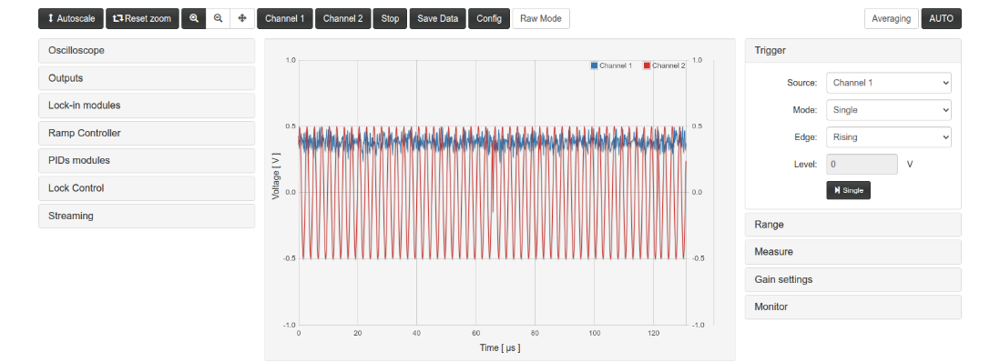

# Remote control

How to control `lock_in+pid_harmonic2` **v2.4.8** (branch `master`) from a program, without the web page. The registers are
described in [FPGA.md](FPGA.md); the meaning of each instrument in [App.md](App.md).

The HTTP API, the Python client and the scripts are those of `lock_in+pid_harmonic` 2.3.17 (later versions of
`_h`, up to 2.3.24, did not change them except the fixes of 2.3.18, in h2 2.4.5) adapted to this App
(two lock-ins, register map shifted from 0x054). Everything addresses registers **by name**, so code written
for `_h` that uses names works here, except for the names that changed: `gen_mod_phase` → `gen_mod_phase_A` /
`gen_mod_phase_B`, `F1_28`/`F2_28` → `X2_28`/`Y2_28`, and the selector labels (`sin_ref`, `cos_1f..3f`, `F1o..F3o`
do not exist on the scope here; `cos_A`, `sin_A`, `cos_B`, `sin_B`, `X2o`, `Y2o`, `signal2_i` do). Code with
numeric offsets of `_h` does **not** work (see the note at the top of [FPGA.md](FPGA.md)).

- [Options](#options)
- [HTTP API](#http-api)
  - [`/lock`: lock module registers](#lock-lock-module-registers)
  - [`/osc`: oscilloscope registers and memory](#osc-oscilloscope-registers-and-memory)
  - [`/data`: the scope of the C controller](#data-the-scope-of-the-c-controller)
  - [Other endpoints](#other-endpoints)
  - [Known issue of the Ecosystem: `POST /data` leaves connections open](#known-issue-of-the-ecosystem-post-data-leaves-connections-open)
- [Python with `requests` only](#python-with-requests-only)
- [Python with `control_finn.py`](#python-with-control_finnpy)
  - [Connection and registers](#connection-and-registers)
  - [Oscilloscope acquisitions](#oscilloscope-acquisitions)
  - [Lock-in, PID, ramp and lock helpers](#lock-in-pid-ramp-and-lock-helpers)
  - [`POST /data` made by each function](#post-data-made-by-each-function)
  - [`example_usage.py`](#example_usagepy)
- [Recipes](#recipes)
  - [Configure the two lock-ins](#configure-the-two-lock-ins)
  - [Configure a PID and the ramp](#configure-a-pid-and-the-ramp)
  - [Close and check a lock](#close-and-check-a-lock)
  - [Read an oscilloscope acquisition](#read-an-oscilloscope-acquisition)
  - [Streaming](#streaming)
- [Running on the board: `c/` and `py/`](#running-on-the-board-c-and-py)
- [SSH version (deprecated)](#ssh-version-deprecated)
- [Coexistence with the web page](#coexistence-with-the-web-page)

## Options

| Way | Where it runs | Status |
|---|---|---|
| **HTTP API** (`/lock`, `/osc`) + Python (`requests`, `control_finn.py`) | any computer on the network | **recommended** |
| `c/lock`, `c/osc`, `py/*.py` | on the Red Pitaya (SSH) | for scripts on the board, e.g. `py/lock_from_registers.py` |
| SSH version (`resources/remote_control/shh_version`, `control_hugo.py`) | computer, through SSH | deprecated, kept for specific cases |

The web page does not need to be open: the App only has to be **loaded** (FPGA image of this App in the
PL). The App is loaded by opening its page once (or by `http://rp-XXXXXX.local/bazaar?start=lock_in+pid_harmonic2`,
with the `+` written literally: `%2B` fails with "Can not load application"). Do not use the endpoints while
another App is loaded: `c/lock` and `c/osc` access the FPGA addresses directly.

Tested on the board by testAgent (v2.4.4-13, 2026-10-11 05:28): `example_usage.py` up to the streaming cell
(0 tracebacks), `py/lock_from_registers.py` by ssh with the page open, and a streaming run
(`reportes/lock-in_pid_h2.md`).

## HTTP API

The endpoints are defined in `lock_in+pid_harmonic2/nginx.conf` (Lua blocks). Base URL:

```
http://rp-XXXXXX.local/lock_in+pid_harmonic2/
```

### `/lock`: lock module registers

`GET /lock_in+pid_harmonic2/lock?<query>` runs `/opt/redpitaya/www/apps/lock_in+pid_harmonic2/c/lock` with the
query as arguments and returns its output as plain text, one line `name:value` per register:

| Query | Command run | Effect |
|---|---|---|
| (none) | `c/lock` | read all the 102 registers |
| `?in1` or `?in1=` | `c/lock in1` | read `in1` |
| `?aux_A=5` | `c/lock aux_A 5` | write 5 to `aux_A` and read it back |
| `?gen_mod_phase_B=630&X2_28&Y2_28` | `c/lock gen_mod_phase_B 630 X2_28 Y2_28` | several reads and writes (order not guaranteed) |

Rules (from `nginx.conf` and `c/lock.c`):

- Only names matching `[A-Za-z0-9_]+` and **integer** values (`-?[0-9]+`) are passed to the shell; other
  arguments are silently dropped (e.g. `?aux_A=0.5` does nothing). A name without `=` reads.
- The arguments come from a Lua table, so **the order of several arguments in one request is not
  guaranteed**. When the order matters (e.g. the two writes of a lock request) use one request per write.
- Values are decimal. Signed registers accept negative values. Unsigned 32-bit registers accept
  0..4294967295 (e.g. `stream_ip`, `lock_trig_time`); a negative value is rejected for unsigned registers
  narrower than 32 bits.
- Errors (answer text, HTTP 200): `ERROR: parameter 'x' not found` (stops at the unknown name),
  `ERROR: <name> is read-only and cannot be written`,
  `ERROR: <name> is not a signed register and you tried to sed value -1`.
- `c/lock` prints signed registers as `int32` and unsigned ones as `uint32`.
- `GET` requests (`/lock`, `/osc`, `/calib`, ...) do not leave open connections on the board (unlike
  `POST /data`, [below](#known-issue-of-the-ecosystem-post-data-leaves-connections-open)).

Example (values seen on the board right after loading the App, defaults):

```bash
curl "http://rp-XXXXXX.local/lock_in+pid_harmonic2/lock?lock_status&lock_control&gen_mod_phase_A&gen_mod_phase_B"
# lock_control:1148
# lock_status:28
# gen_mod_phase_A:0
# gen_mod_phase_B:0
```

The register list (name, index, signed, read-only, min, max) is served at
`/lock_in+pid_harmonic2/c/lock.txt` ([FPGA.md](FPGA.md#register-description-files-locktxt-osctxt)).

**Reading live signals.** The bus reads of the lock module are exact in this FPGA (the fix of `_h` 2.3.17, since
v2.4.3): 0 bad reads of `in1` (0x0E0) and `oscA` (0x0F0) in 2000 reads each on the board; with the FPGA of v0.4.2
the simulation gave 2000/2000 unstable reads. The value read is the one of the clock before the read.

### `/osc`: oscilloscope registers and memory

`GET /lock_in+pid_harmonic2/osc?<query>` runs `c/osc` the same way, on the 21 registers of the scope listed
in `/lock_in+pid_harmonic2/c/osc.txt`: `conf`, `TrgSrc`, `ChAth`, `ChBth`, `TrgDelay`, `Dec`, `CurWpt`,
`TrgWpt`, `ChAHys`, `ChBHys`, `AvgEn`, `PreTrgCnt`, `ChAEqFil1..4`, `ChBEqFil1..4` and **`TrgUnlock`**
(index 37, offset `0x94`, write 1; reads 0; in `c/osc` since v2.4.4).

- `?Dec&conf=2`: read `Dec`, write 2 to `conf` (reset of the write state machine).
- `?TrgUnlock=1`: unlock the trigger of the 2.0 scope (see below).
- `?dump`: 16384 lines `:<chA>:<chB>` with the content of both sample buffers (14-bit signed, in buffer
  order, not rotated), followed by the 21 registers `name:value`. Rotate with `CurWpt` and place t = 0 with
  `TrgWpt` (see `control_finn.py` `Osc.curv()` and the [recipe](#read-an-oscilloscope-acquisition)).

**Triggered acquisition on the 2.0 scope.** The scope of the 2.0 FPGA **locks its trigger after every
trigger** (`TrgSrc` bit 5 reads 1) and ignores new triggers until 1 is written to `TrgUnlock`. The sequence is
the same as the one of the C controller (`src/fpga.c` `osc_fpga_set_trigger()`, `osc_fpga_triggered()`):

1. `conf=2` (reset), then `Dec`, `TrgDelay` (= 16384 − samples before the trigger), `ChAth`/`ChAHys`, `AvgEn`, ...
2. `conf=1` (arm) and wait for the pre-trigger samples (`samples_before · 8 ns · Dec`).
3. `TrgUnlock=1`, then `TrgSrc=<source>` (1 now, 2/3 ch A rising/falling, 4/5 ch B, 6/7 external = lock trigger).
4. End of the acquisition: `conf` bit 4 = 1 on the 2.0 scope. `TrgSrc == 0` alone is not a valid test on 2.0.
5. `?dump`.

Before acquiring, stop the scope of the C controller, otherwise its worker re-arms the same scope with the
`Dec`/`TrgDelay` written by you and the trace mixes both acquisitions (next section).

### `/data`: the scope of the C controller

After `bazaar?start` the C controller (`controllerhf.so`) keeps acquiring in **Auto with no web page
open**, on the same scope. It is stopped by setting its trigger mode to **Single** (`trig_mode` = 2: the
worker resets and configures the scope once and then does not arm it), which is what a Single acquisition of
the page does:

```bash
curl -s -X POST -H 'Content-Type: application/json' \
     -d '{"datasets":{"params":{"trig_mode":2}}}' http://rp-XXXXXX.local/data
# {"app":{"id":"lock_in+pid_harmonic2"},"datasets":{"params":{..., "trig_mode":2, ...}}}
```

`trig_mode` 0 gives the scope back in Auto, 1 in Normal; `{}` (empty params) only reads. Rules (found on
`_h`, same handler):

- Use **only `POST /data`**. `GET /data` with another 2.0 App loaded crashes the nginx worker; check
  `app.id` in the answer of a POST before acting.
- The `/data` handler of the Ecosystem only reads the body that arrives **in the same TCP segment as the
  headers**. `curl` does so; Python `requests` / `http.client` send headers and body in two `send()` calls and
  often get no answer. `control_finn.py` sends the whole request in one `send()` (`_post_json_one_send()`, own
  socket, `Connection: close`, 0.8 s per attempt and 2 retries: `DATA_TIMEOUT`, `DATA_RETRIES`).
- Every `POST /data` leaves one open connection on the board: see below.

### Other endpoints

| Endpoint | Answer |
|---|---|
| `/lock_in+pid_harmonic2/calib` | output of `/opt/redpitaya/bin/calib -rv` (calibration constants, `NAME = value` lines) |
| `/lock_in+pid_harmonic2/get_ip` | IP of the client |
| `/lock_in+pid_harmonic2/streaming` | starts `c/streaming` (see [Streaming](#streaming)); answers `OK` |
| `/lock_in+pid_harmonic2/check_streaming` | `0` if `c/streaming` is running, `1` if not |
| `/lock_in+pid_harmonic2/restart_server` | restarts the nginx of the board (`systemctl restart redpitaya_nginx`) |

### Known issue of the Ecosystem: `POST /data` leaves connections open

On Ecosystem 2.0 (OS 2.04-35) **every `POST /data` leaves one connection in CLOSE-WAIT** in the nginx worker of
the board (the page, `curl` and Python alike; `GET` requests do not). The worker has 1024 file descriptors, so
after about 1000 POST since nginx was (re)started **the web server of the board stops answering** until nginx is
restarted. Not a bug of the App (module `ngx_http_rp_module` of Red Pitaya). In the v2.4.4 test session the count
went 0 → 227 (page + `example_usage.py` + streaming).

- Count them on the board: `ss -tn state close-wait '( sport = :80 )' | tail -n +2 | wc -l`.
- Release them: `ssh root@rp-XXXXXX.local systemctl restart redpitaya_nginx` (or
  `GET /lock_in+pid_harmonic2/restart_server`), then `bazaar?start=lock_in+pid_harmonic2`, which **reloads the
  FPGA image** (registers back to their reset values, an active lock is lost). Whether the nginx restart alone
  affects the FPGA or a running lock: **a confirmar**.
- `control_finn.py` keeps `POST /data` to the minimum ([table](#post-data-made-by-each-function));
  `rp.osc.post_count` counts the ones made by a script.

## Python with `requests` only

A minimal client for the registers, enough for most scripts (for `POST /data` use `control_finn.py` or
`curl`, see above):

```python
import requests

URL = 'http://rp-XXXXXX.local/lock_in+pid_harmonic2'

def lock_get(*names):
    """Read lock registers; returns a dict name -> int."""
    r = requests.get(f'{URL}/lock', params={n: '' for n in names}, timeout=5)
    r.raise_for_status()
    if 'ERROR' in r.text:
        raise ValueError(r.text)
    return {k: int(v) for k, v in (l.split(':') for l in r.text.strip().split('\n'))}

def lock_set(name, value):
    """Write one lock register (integer) and return the value read back."""
    r = requests.get(f'{URL}/lock', params={name: int(value)}, timeout=5)
    r.raise_for_status()
    if 'ERROR' in r.text:
        raise ValueError(r.text)
    return int(r.text.strip().split(':')[1])

print(lock_get('in1', 'in2', 'lock_status'))
lock_set('gen_mod_phase_B', 630)     # references of lock-in B at 90 deg
```

`requests` resolves the host name in every request; a `.local` (mDNS) lookup can take seconds on some PCs.
For long loops use the IP of the board, or `control_finn.py`, which resolves the name once.

## Python with `control_finn.py`

`resources/remote_control/http_version/control_finn.py` (Python ≥ 3.8 with `requests`, `numpy` and, for plots,
`matplotlib`) wraps the API. `example_usage.py` in the same folder runs every feature cell by cell (`#%%` cells;
the URL can be given in the environment variable `RP_URL`). Every function has a docstring.

### Connection and registers

```python
from control_finn import RedPitayaApp, reg_labels, WebScopeNotStopped, AcquisitionTimeout

rp = RedPitayaApp('http://rp-XXXXXX.local/lock_in+pid_harmonic2/?type=run')   # URL copied from the browser
rp.ip                             # IP used for all the requests (host name resolved once)

rp.lock.aux_A                     # read one register
rp.lock.aux_A = 5                 # write one register (integers only)
rp.lock.oscA_sw = 'cos_ref'       # selectors accept the labels of the UI (reg_labels)
rp.lock.oscB_sw = 'sin_A'         # this App: sin_A instead of sin_ref
rp.lock.get()                     # dict with all the lock registers
rp.lock.get('in1 in2 error')      # several registers
rp.lock.set({'aux_A': 0, 'aux_B': 0})
rp.osc.get()                      # all the scope registers
```

`reg_labels` of this App was generated from the `<select>` of its `index.html` (`control_finn.py` l. 112-160):
`oscA_sw`/`oscB_sw` with `cos_A`..`sin_B`, `X2o`, `Y2o`, `signal2_i`; `signal2_sw`; `error_sw`, `pidX_sw` and
`lock_trig_sw` with `X2o`, `Y2o`. The labels of the "(n/a)" signals are kept (they select 0).

| Method / attribute | What it does |
|---|---|
| `rp.ip`, `rp.resolve()`, `rp.resolve_time` | IP used for the requests / resolve it again / time of the last resolution (`RedPitayaApp(url, resolve=False)` resolves in every request) |
| `rp.lock.<reg>`, `.get()`, `.set()` | read / write lock registers (names from `c/lock.txt` of the board; labels of `reg_labels`) |
| `rp.osc.<reg>`, `.get()`, `.set()` | the same for the scope registers |
| `rp.calib` | constants of `/calib` (used by `curv(raw=False)` and `get_XY()` when the input is `in1`/`in2`; otherwise 8192 counts = 1 V) |
| `rp.save_params()`, `rp.save_last_meas()`, `RedPitayaApp('<file>.npy')`, `rp.load_params()` | save registers (and the last trace) to `.npy`, open it offline, write its read/write registers back |
| `rp.streaming_prepare()`, `.streaming_start()`, `.streaming_stop()` | streaming |
| `HTTP_TIMEOUT` (10 s), `DATA_TIMEOUT` (0.8 s), `DATA_RETRIES` (2) | module constants |

### Oscilloscope acquisitions

```python
rp.lock.oscA_sw = 'cos_ref'; rp.lock.oscB_sw = 'sin_A'
tt, ch1, ch2 = rp.acquire('A_rising', dec=256, trig_pos=20)      # measure + wait + curv, volts
tt, ch1, ch2 = rp.acquire('manual', dec=64, trig_pos=0.5, raw=True)
rp.lock.trig_sw = 'Scan floor'
tt, ch1, ch2 = rp.acquire('ext_rising', dec=1024, trig_pos=0.1, timeout=20)   # lock module trigger
rp.plot_meas()
rp.scope_auto()                   # give the scope back to the web page (Auto)
```


| Method | What it does |
|---|---|
| `rp.acquire(trig, dec=1, trig_pos=0.5, threshold=0, hysteresis=63, average=None, timeout=10, raw=False, stop_web_scope=None, check_web_mode=False)` | `measure(wait=True)` + `curv()`: returns `t, ch1, ch2` (t = 0 at the trigger; volts, or counts with `raw=True`) |
| `rp.osc.measure(trig, dec, trig_pos, threshold, hysteresis, average, wait, timeout, stop_web_scope, check_web_mode)` | prepare and arm an acquisition with the [sequence above](#osc-oscilloscope-registers-and-memory). `trig`: `'manual'`, `'A_rising'`, `'A_falling'`, `'B_rising'`, `'B_falling'`, `'ext_rising'`, `'ext_falling'` or 1..7; `dec` 1..1048575; `trig_pos` a fraction 0..1 or the number of samples before the trigger |
| `rp.osc.wait(timeout)`, `rp.wait_osc_finish()`, `rp.osc.acq_done()` | wait for / test the end of the acquisition (`conf` bit 4 on 2.0); `AcquisitionTimeout` on timeout (e.g. `ext_rising` on Scan floor while the ramp is stopped by a lock) |
| `rp.osc.unlock_trigger()`, `rp.osc.trigger_locked()`, `rp.osc.has_unlock` | write `TrgUnlock` / read `TrgSrc` bit 5 / `c/osc` of the board knows `TrgUnlock` |
| `rp.osc.dump()`, `rp.osc.curv(data=None, raw=True)` | read the buffers; `curv` returns `t, ch1, ch2` ordered and with t = 0 at the trigger |
| `rp.scope_stop(force=False)`, `rp.scope_auto('auto' \| 'normal')`, `rp.scope_mode()` | stop the scope of the C controller (Single) / give it back in Auto or Normal / read its `trig_mode` |
| `rp.osc.auto_stop_web_scope` (default `True`) | `measure()` / `acquire()` stop the scope of the C controller first |
| `rp.osc.post_count`, `rp.osc.scope_stop_error`, `rp.osc.web_check_reason` | number of `POST /data` attempts / why the last `scope_stop()` failed / why the cached Single was dropped |
| `rp.osc.check_not_overwritten()` | warns if `Dec`/`TrgDelay` changed after `measure()` |
| `rp.plot_meas()` | quick plot of the last trace (or of a saved file) |

**Automatic stop of the web scope.** `measure()` / `acquire()` call `scope_stop()` first: the first time it asks
the controller with `POST /data {}` and, if it was not in Single, posts `trig_mode` = 2 and waits until the worker
has reset the scope; the Single is then remembered and the next calls check it with `GET /osc` only (two reads of
`conf`, `TrgSrc`, `Dec`, `TrgDelay`, `CurWpt`, `TrgWpt` 50 ms apart). If Single can not be confirmed,
`measure()` / `acquire()` raise **`WebScopeNotStopped`** without touching the scope. With the page open,
`acquire()` puts it in Single:




The details and limits of these checks are the same as in `_h` (docstrings of `scope_stop()`,
`_web_still_stopped()` and `check_not_overwritten()`).

### Lock-in, PID, ramp and lock helpers

Each one writes only the arguments given and returns the resulting state. The lock-in helpers take a **`line`**:
`'A'` (or 0, `'ref'`, `'x'`, `'xy'`): lock-in A; `'B'` (or 1, `'x2'`, `'xy2'`): lock-in B (`control_finn.py`
l. 1205-1415).

| Method | What it does |
|---|---|
| `rp.set_signal(sw, line='A')` | input of the lock-in: `signal_sw` (A) or `signal2_sw` (B): `'in1'`, `'in2'`, `'in1-in2'`, `'cos_ref'`, `'aux_A'`, `'Ramp A'` (`'sin_ref'`, `'cos_1f'` select 0) |
| `rp.get_freq()`, `rp.get_period()`, `rp.set_freq(hp)`, `rp.set_freq_hz(f)` | modulation frequency (`gen_mod_hp` 0..16383; `set_freq_hz` takes the closest value, 3.03 Hz .. 49.603 kHz) |
| `rp.set_phase(val, line='A')` | `gen_mod_phase_A` / `gen_mod_phase_B`, 0..2519 (returns degrees; 630 = 90°) |
| `rp.set_modulation_amplitud(val, ch='out1')` | `mod_out1`/`mod_out2` (−1 off .. 8191; both add `cos_ref`) |
| `rp.set_lpf(tau_exponent, order, line='A')`, `rp.get_lpf(line=None)` | low-pass filters: τ = 8 ns·2^tau_exponent (14..29), order 0..2, `line` `'A'` (`lpf_F0`), `'B'` (`lpf_F1`), `'all'` or a list; `get_lpf()` returns a dict `'A'`/`'B'` → (τ, order) |
| `rp.set_gain(line, amp)` | `sg_amp0` (A, exponent 0..19) / `sg_amp1` (B, 0..9), exponent or label `'x32'`; returns the factor |
| `rp.get_XY(units='V', F=False)` | X, Y of lock-in A; with `F=True` **X, Y, X2, Y2**. Read from the 28-bit registers at the same instant (`read_ctrl[0]`), in volts (calibration of the input of each lock-in) or counts·2¹¹ (`units='int'`) |
| `rp.set_pid(pid='A', sw, sp, kp, ki, kd, PSR, ISR, DSR, SAT, ctrl)`, `rp.get_pid(pid)`, `rp.pid_reset(pid)` | PID A / B (labels accepted: `sw='X2o'`, `PSR='/1024'`, `ISR='537 ms'`); `get_pid` adds `in`, `out` and the effective `enabled` from `lock_status` |
| `rp.set_ramp(step, low, high, enable, sawtooth, direction, B_factor, reset)`, `rp.get_ramp()` | ramp registers (`step` = `ramp_step`: a **smaller** step is a **faster** ramp) |
| `rp.set_manual(ramp, pidA, pidB)` | manual enables (`lock_control` bits 4:2); a change while LOCKED releases the lock |
| `rp.lock_config(trig='time', time=None, time_ticks=None, level=None, level_V=None, signal=None, rise=True, final=('pidA',), manual=None)` | lock configuration without request (`signal` accepts `'X2o'`, `'Y2o'`…). **Releases an active lock** |
| `rp.lock_launch(timeout=None)`, `rp.lock_now()`, `rp.lock_release()` | Trigger Lock (with `timeout` it waits for LOCKED) / Lock Now / release |
| `rp.lock_status()`, `rp.wait_locked(timeout=10)`, `rp.get_lock_control()` | decoded `lock_status` / wait for LOCKED / decoded `lock_control` |

Seen on the board (v2.4.4): `set_freq_hz(10e3)` → 9920.63 Hz, `set_freq(255)` → 193.76 Hz; `set_phase(0)` and
`set_phase(630, line='B')` → 0x098 = 0, 0x09C = 630; `get_XY(F=True)` = [−220.7, 24.85, 24.85, 220.7] (X2 = Y,
Y2 = −X).

### `POST /data` made by each function

Only the scope functions use `POST /data`; the register access and all the helpers of the previous table are
GET requests.

| Call | `POST /data` |
|---|---|
| `scope_mode()` | 1 |
| `scope_auto()` | 1 |
| `scope_stop()` | 0 while the confirmed Single holds (GET check); otherwise 1 if the controller was already in Single, 2 if it was running. `force=True`: always 1 or 2 |
| `measure()` / `acquire()` | as `scope_stop()` (normally 0 after the first one); + 1 with `check_web_mode=True`; 0 with `stop_web_scope=False` |
| everything else | 0 |

### `example_usage.py`

Cells: connect; acquisition with `oscB_sw = 'sin_A'` (this App has no `sin_ref` on the scope); `acquire()`;
manual and external trigger; give the scope back (`scope_auto()`); save and load data; **Lock-in** (both
lock-ins: `set_signal('in1')`, `set_signal('in1', line='B')`, `set_freq_hz(10e3)`, `set_freq(255)`, phase A 0
and B 630, filters, gains, `get_XY(F=True)`); PID; Ramp (the ramp of `lock_mode`: ±5000, step 400, ~64 ms);
Lock (time trigger 16.58 ms, level 0.1 V, lock now); all registers; labels; load a config saved by the web page
(`RP.json`, RW registers only); streaming.

Notes from the test (testAgent 2026-10-11 05:28):

- Run entirely, **the script ends with the scope of the web page stopped**: the cell "save data and load it
  later", after "Give the scope back to the web page", calls `osc.measure()` (Single) and nothing gives it back;
  the page stayed ~105 s without polling (and showed a stale lock state) until it was touched. Call
  `rp.scope_auto()` at the end (proposal for devAgent: add it to that cell).
- The Lock-in cell sets `set_modulation_amplitud(-1, ch='out1')` (no modulation on OUT1) and the PID cell kp =
  ki = 0, so after them the Lock cell closes a "lock" without useful feedback (the state machine still goes to
  LOCKED: in the test run the time, level and lock-now requests of the cell all reached LOCKED). Restore the
  modulation and the PID of your configuration before that cell for a real lock.
- An `ext_rising` acquisition on *Scan floor* times out (`AcquisitionTimeout`) while a lock holds the ramp
  stopped (expected).

## Recipes

Values in counts: 8192 counts = 1 V. The examples use `rp` of `control_finn.py`; the register writes behind
each helper are shown where they matter, with the `lock_get` / `lock_set` helpers of the
[`requests`-only client](#python-with-requests-only).

### Configure the two lock-ins

```python
rp.set_freq(0)                                    # modulation 125e6/2520 = 49.6 kHz (gen_mod_hp = 0)
rp.set_modulation_amplitud(100, ch='out1')        # add cos_ref with ~50 counts (~6 mV) to OUT1 (mod_out1)

# lock-in A: error signal
rp.set_signal('in1')                              # signal_sw = 0
rp.set_phase(0)                                   # gen_mod_phase_A (2520 = 360 deg)
rp.set_lpf(tau_exponent=15, order=2, line='A')    # X,Y: tau = 8 ns * 2**15 = 262 us (lpf_F0 = 2<<4 | 1)
rp.set_gain('A', 'x32')                           # Xo, Yo gain x32 (sg_amp0 = 5)

# lock-in B: the same input in quadrature (X2 = Y, Y2 = -X), or another detector ('in2')
rp.set_signal('in1', line='B')                    # signal2_sw = 0
rp.set_phase(630, line='B')                       # gen_mod_phase_B = 90 deg
rp.set_lpf(tau_exponent=14, order=2, line='B')    # lpf_F1
rp.set_gain('B', 'x1')                            # sg_amp1 = 0

rp.lock.error_sw = 'Yo'                           # error = Yo (error_sw = 2); 'X2o', 'Y2o' also possible
rp.lock.error_offset = 0
X, Y, X2, Y2 = rp.get_XY(F=True)                  # volts, read at the same instant
```

`get_XY()` freezes the copies with `read_ctrl[0]`; by hand:

```python
lock_set('read_ctrl', 1)                      # freeze the copies
r = lock_get('X_28', 'Y_28', 'X2_28', 'Y2_28')
lock_set('read_ctrl', 0)
X, Y, X2, Y2 = (r[k] / 2**11 / 8192 for k in ('X_28', 'Y_28', 'X2_28', 'Y2_28'))   # volts
```

### Configure a PID and the ramp

```python
rp.set_pid('A', sw='error', sp=0, kp=-250, PSR='/1024',   # kp = -0.244 (lock_mode config since 2026-10-12)
           ki=-20, ISR='537 ms',                          # tau_i = 537 ms / 20 = 26.8 ms
           kd=0, SAT=13, ctrl=0)                          # integral term limited to +-1 V
rp.lock.out1_sw = 'ctrl_A'                                # OUT1 = PID A + ramp A (out1_sw = 12)

# ramp of the lock_mode test config: triangle +-5000 counts, step 400 -> ~64 ms
rp.set_ramp(step=400, low=-5000, high=5000, sawtooth=False, enable=True)
rp.set_manual(ramp=True, pidA=False, pidB=False)          # "Scan enable": the ramp runs, PIDs off
print(rp.get_pid('A'), rp.get_ramp(), rp.lock_status())
```

Ramp period: `T = (high − low) · (step + 1) · 8 ns · (2 − sawtooth)` ([FPGA.md](FPGA.md#ramp-scan)). The time
trigger must be shorter than half the period of a triangle ramp.

### Close and check a lock

The lock control is commanded only with `lock_control` and observed in `lock_status`
([`lock_control.md`](../lock_in+pid_harmonic2/doc/lock_control.md)). Both registers are at the same addresses as
in `_h` (0x018, 0x01C).

```python
# time trigger: 16.58 ms after the scan floor, PID A on while locked
rp.lock_config(trig='time', time=16.58e-3, final=('pidA',))
st = rp.lock_launch(timeout=10)       # Trigger Lock and wait for LOCKED
print(st)                             # {'armed': False, 'locked': True, 'pidB': False, 'pidA': True, 'ramp': False, 'count': ..., 'raw': ...}

r = rp.lock.get('error_mean error_std')
mean = r['error_mean'] / 2**18
std  = max(r['error_std'] / 32 - mean**2, 0) ** 0.5    # counts (8192 = 1 V)

rp.lock_release()                     # back to the manual enables (scan running)

# level trigger: error crossing 0.1 V upwards (signal='X2o' would use lock-in B)
rp.lock_config(trig='level', level_V=0.1, signal='error', rise=True, final=('pidA',))
rp.lock_launch(); rp.wait_locked(timeout=10); rp.lock_release()
```

The same sequence with plain register writes (as `py/lock_from_registers.py`):

```python
import time

def lock_control_value(now=0, launch=0, manual=('ramp',), final=('pidA',), trig_type=1, rise=1):
    bit = {'pidB': 0, 'pidA': 1, 'ramp': 2}
    v = (now & 1) | (launch & 1) << 1
    v |= sum(1 << (2 + bit[x]) for x in manual)     # enables while not locked
    v |= sum(1 << (5 + bit[x]) for x in final)      # enables while locked
    return v | (trig_type & 3) << 8 | (rise & 1) << 10

lock_set('lock_trig_time', round(16.58e-3 / 8e-9))      # 2072500 ticks of 8 ns (0 .. 2**32-1)
# (level trigger instead: lock_trig_sw = 0 (error; 3 = X2o, 4 = Y2o), lock_trig_val = 5085, trig_type = 2)
base = lock_control_value(trig_type=1)                  # 0x550 = 1360
lock_set('lock_control', base)                          # configuration without request (releases a lock)
lock_set('lock_control', base | 2)                      # arm (Trigger Lock); base | 1 = Lock Now
t0 = time.time()
while not (lock_get('lock_status')['lock_status'] >> 1 & 1) and time.time() - t0 < 10:
    time.sleep(0.01)
lock_set('lock_control', base)                          # release
```

Notes:

- A lock request needs a **0→1 edge** of bit 0 or 1: write the value without the request first. Writing
  the same value again does nothing.
- The ramp runs only if `ramp_enable` (**0x0BC** in this App) is also 1.
- Changing a manual enable (bits 4:2) while LOCKED releases the lock.
- `lock_trig_time` is 32 bits unsigned (up to 34.36 s). Written through `/lock` the value is exact; written from
  the web page it is rounded to float32 above 2²⁴ ticks.
- Since v2.4.7 (FPGA) the time trigger only counts from a scan floor of a ramp that kept running: a Trigger Lock
  armed right after a release or with the ramp stopped waits for the next floor and fires at floor + time (before,
  it could fire in the middle of the scan). The `time=16.58e-3` / `timeout=10` of the examples are for the 64 ms
  scan of the test configuration; with slow ramps use a timeout longer than the period.

### Read an oscilloscope acquisition

`rp.acquire()` does everything. By hand, after an acquisition (yours, or one made by the page, e.g. a Single or a
lock capture):

```python
import numpy as np

r = requests.get(f'{URL}/osc', params={'dump': ''}, timeout=10).text.strip().split('\n')
cha = np.array([int(l.split(':')[1]) for l in r if l.count(':') == 2])
chb = np.array([int(l.split(':')[2]) for l in r if l.count(':') == 2])
reg = {l.split(':')[0]: int(l.split(':')[1]) for l in r if l.count(':') == 1}

cur, trg = (reg['CurWpt'] + 1) % 16384, reg['TrgWpt']
cha, chb = np.roll(cha, -cur), np.roll(chb, -cur)       # oldest sample first
t = (np.arange(16384) - (trg - cur) % 16384) * 8e-9 * reg['Dec']   # t = 0 at the trigger
# cha, chb in counts of the signals chosen by oscA_sw / oscB_sw (8192 = 1 V)
```

### Streaming

```python
def ip_to_reg(ip):                         # 'a.b.c.d' -> a + b<<8 + c<<16 + d<<24
    return sum(int(v) << (8 * i) for i, v in enumerate(ip.split('.')))

rp.lock.oscA_sw = 'cos_ref'; rp.lock.oscB_sw = 'sin_A'  # channels to stream
rp.lock.stream_ip = ip_to_reg('192.168.1.10')           # register 0x188 in this App
rp.lock.stream_port = 6000
rp.lock.stream_rate = 128                               # decimation 128: 0.98 MS/s
rp.streaming_prepare()                                  # start c/streaming on the board (GET /streaming)
rp.streaming_start()                                    # stream_cmd = 1 (a receiver must be listening)
# ...
rp.streaming_stop()                                     # stream_cmd = 0
```

The receiver (`resources/streaming/server`, or `nc -l <port> > file.bin`) and the format of the data are
described in `resources/README.md` (`resources/streaming/read_bin.py` reads the file). Tested on the board from
the page (v2.4.3-12 and v2.4.4: 976.4-976.5 kS/s, 0 lost without other activity on the board; Stop in ≤ 70 ms);
the streaming cell of `example_usage.py` was not run in the tests.

## Running on the board: `c/` and `py/`

On the board (`ssh root@rp-XXXXXX.local`), in `/opt/redpitaya/www/apps/lock_in+pid_harmonic2/`:

```bash
c/lock                      # all lock registers (102)
c/lock in1 in2 out1 out2    # read some
c/lock gen_mod_phase_B 630 X2_28 Y2_28   # write and read
c/osc                       # scope registers (21, with TrgUnlock)
c/osc dump                  # buffers + registers
python3 py/lock_from_registers.py --status
python3 py/lock_reg_table.py               # the register map of this App
```

`py/hugo.py` is a Python module with the register tables of this App (mmap of `/dev/mem`, generated by
`config_tool.py`) used by the other scripts: `lock.py`/`osc.py` (read/write like `c/lock`/`c/osc`),
`lock_reg_table.py` (print the table), `osc_get_ch.py`, `osc_trig.py`, `data_dump.py`, `data_dump_file.py` and
`lock_from_registers.py`.

**`py/lock_from_registers.py`** closes the lock writing only FPGA registers (`--status`, `--trig time|level|both`,
`--time 16.58ms`, `--level 5085|0.5V`, `--sw`, `--rise/--fall`, `--set pidA,pidB`, `--now`, `--release`,
`--force`, `--timeout`). Tested by ssh with the page open (v2.4.4): `--trig time --time 16.58ms --set pidA`
LOCKED in 0.028 s, `--trig level --level 5085` in 0.049 s, `--trig time --time 2072622` in 0.022 s, `--now`,
`--release`, `--time 20s` → ARMED with 2500000000; the page followed OFF/ARMED/LOCKED, the Time trigger field and
the Trigger type with 0 POST. Up to v2.4.4 `--time 40s` ended with `OverflowError` and the docstring listed
`lock_trig_sw` 3/4 as "F1/F2"; since v2.4.5 the time is clamped to 0..2³²−1 ticks with a message and the docstring
says 3 X2o, 4 Y2o.

The scripts other than `lock_from_registers.py` and `lock_reg_table.py` have not been re-tested on the 2.x
version (**a confirmar**); `osc_trig.py` waits for `TrgSrc == 0`, which is not valid on the 2.0 scope. Running
them creates `py/__pycache__/` on the board (harmless).

## SSH version (deprecated)

`resources/remote_control/shh_version/` (`control_hugo.py`, `example.py`, `example_streaming.py`,
`config_RP.py`, …) controls the App by running the `py/` scripts on the board through SSH. It predates the
HTTP API and is kept only for specific cases (e.g. long acquisitions written on the board). `control_hugo.py`
is the one of `_h` 2.3.17 (`launch_lock()`, `lock_now()`, `release_lock()`, `lock_status()` with `lock_status`).
Not tested on this App (**a confirmar**). New scripts should use the HTTP API.

## Coexistence with the web page

- The web page and a script can be used at the same time: the page reads the registers on every request
  and shows changes made from outside (e.g. a lock closed from Python), without sending anything back.
- The C controller writes `lock_control` only when the user changes a lock button or checkbox, and (v2.4.5)
  `lock_trig_time`, `lock_trig_val`, `lock_trig_sw` only when the user changes them; values written to these
  four registers from a script are copied to the parameters of the page (shown and kept). **The other lock
  registers are rewritten with the controller's copy when the user changes any lock parameter in the
  page**, so a value written from a script can be overwritten by a later change in the page.
- The scope is shared: `control_finn.py` stops the scope of the controller / page before acquiring and leaves it
  in Single; give it back with `rp.scope_auto()` or with *Auto* in the page.
- Every change made in the page is a `POST /data` and counts for the
  [open connections](#known-issue-of-the-ecosystem-post-data-leaves-connections-open) of nginx.
- Opening the page in a new tab restores that tab's state and sends the transient commands
  (`lock_ctrl_aux_lock_now`, `lock_ctrl_aux_launch_lock_trig`, `lock_stream_cmd`) as 0
  (`index.html` l. 208, `state_transient_zero`), which **probably releases an active lock** (a confirmar).
