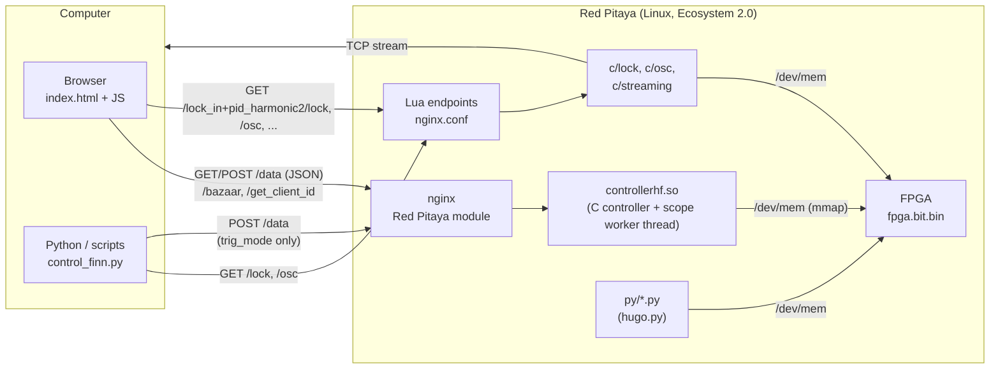
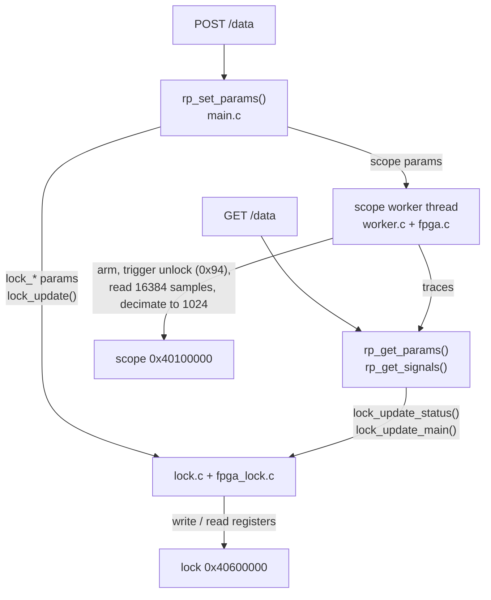
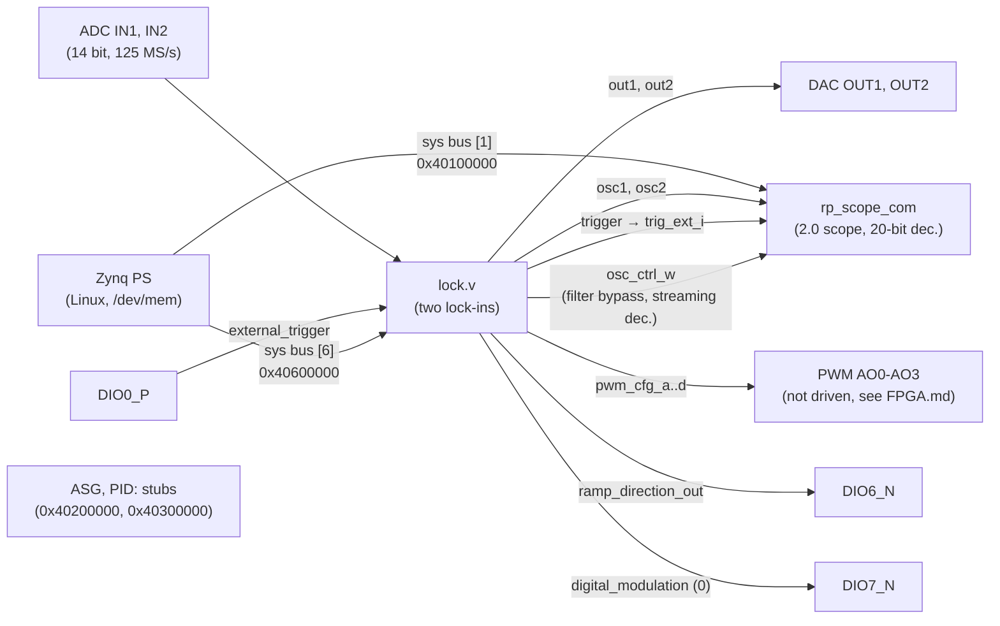
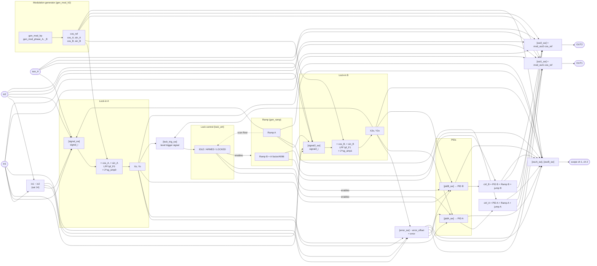
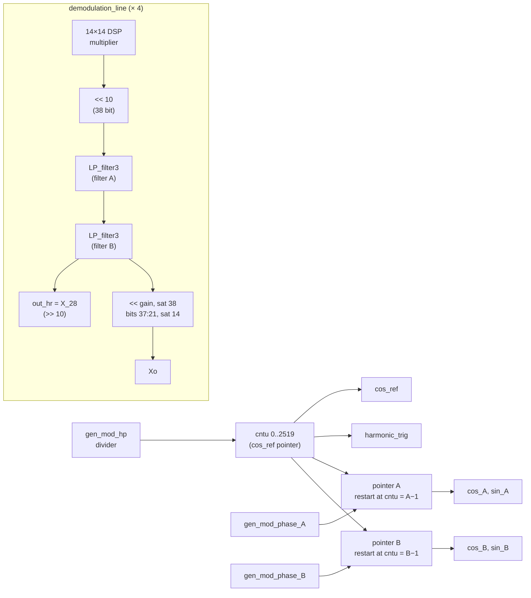
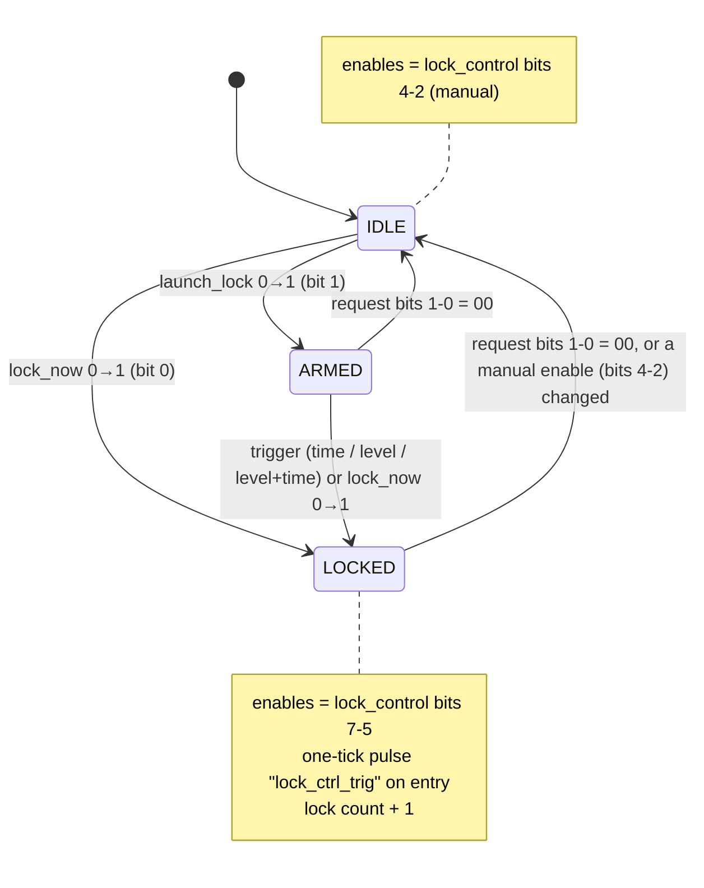
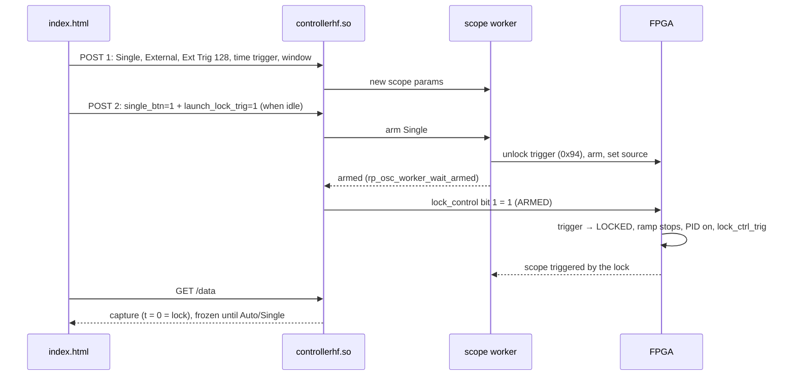

# Internal structure

How `lock_in+pid_harmonic2` v2.4.8 (branch `master`) is built: the three layers (web page, server, FPGA), how they talk, and
how the instruments are connected inside the FPGA. Registers: [FPGA.md](FPGA.md). Specifications:
[App.md](App.md). Source tree and build: [Devel.md](Devel.md).

- [Layers](#layers)
- [Web page ↔ server](#web-page--server)
- [Server ↔ FPGA: the C controller](#server--fpga-the-c-controller)
- [Inside the FPGA](#inside-the-fpga)
  - [Top level](#top-level)
  - [Signal flow of the lock module](#signal-flow-of-the-lock-module)
  - [Modulation generator and the two lock-ins](#modulation-generator-and-the-two-lock-ins)
  - [Lock control](#lock-control)
  - [Scope and streaming](#scope-and-streaming)
- [Parameters, registers and `config_tool.py`](#parameters-registers-and-config_toolpy)

## Layers

As described for the original [Lock-in+PID](https://marceluda.github.io/rp_lock-in_pid/TheApp/instruments/instruments_01_intro/),
the App has a client-server structure on top of a programmable circuit:

- **Client**: `index.html` (HTML + jQuery + Flot, all in one file) runs in the browser. It polls the
  server, draws the scope and sends parameter changes.
- **Server**: the nginx of the Red Pitaya Ecosystem loads `controllerhf.so` (the App controller) when the
  App is started with `/bazaar?start=lock_in+pid_harmonic2` (write the `+` literally: bazaar does not decode
  `%2B`); on Ecosystem 2.0 the FPGA image `fpga.bit.bin` is loaded at the start by `fpga.sh` (`fpgautil`). The
  App also adds its own HTTP endpoints, written in Lua inside `nginx.conf`, which run the small C tools of `c/`.
- **Hardware**: the FPGA (`lock.v` and the Red Pitaya scope) does all the real-time processing. The
  software only reads and writes registers; changing a function means changing a register, not the circuit.

This structure is the one of `lock_in+pid_harmonic` 2.3.24 (ported up to h2 2.4.8); the C controller, the endpoints and the page logic
are the same code with the names of this App. What is specific of this App is inside the FPGA (the generator
and the two lock-ins) and in the parameters/registers that reach it.

## Web page ↔ server

| Endpoint | Method | Who | What |
|---|---|---|---|
| `/bazaar?start=lock_in+pid_harmonic2` / `?stop=` | GET | page at start / Restart | start the App (controller + FPGA) / stop the loaded App |
| `/data` | GET | page, polling (~50 ms; 500 ms with a frozen capture) | parameters (JSON `datasets.params`) and the two scope traces (`datasets.signals`, 1024 points). The page tolerates 2 consecutive failures and shows the error dialog at the 3rd (`MAX_CONSECUTIVE_FAILS`, `index.html` l. 95; specific of this App) |
| `/data` | POST | page, on each change; `control_finn.py` (`trig_mode` only) | changed parameters only, in chunks of at most 600 bytes, with retries. A failed chunk (E3) is shown as a toast, not as a dialog (`index.html` l. 5089; specific of this App). Every POST leaves a CLOSE-WAIT connection in nginx ([Remote.md](Remote.md#known-issue-of-the-ecosystem-post-data-leaves-connections-open)) |
| `/get_client_id`, `/set_client_id` | GET/POST | page | claim the board like the factory Apps; detect another client |
| `/lock_in+pid_harmonic2/lock?…` | GET | page (streaming IP), Python | run `c/lock`: read/write lock registers ([Remote.md](Remote.md)) |
| `/lock_in+pid_harmonic2/osc?…` | GET | Python | run `c/osc`: read/write scope registers (with `TrgUnlock`), dump the scope memory |
| `/lock_in+pid_harmonic2/get_ip` | GET | page (IP button) | IP of the client |
| `/lock_in+pid_harmonic2/calib` | GET | Python | output of `calib -rv` (calibration of the board) |
| `/lock_in+pid_harmonic2/streaming` | GET | page (Prepare Streaming) | start `c/streaming` detached (`c/stream_start.sh`) |
| `/lock_in+pid_harmonic2/check_streaming` | GET | page | 0 if `c/streaming` is running, 1 if not |
| `/lock_in+pid_harmonic2/restart_server` | GET | — | `systemctl restart redpitaya_nginx` |
| `/lock_in+pid_harmonic2/reload_fpga` | GET | — | 0.9x only; on 2.0 answers HTTP 501 and does not touch the FPGA |

The page keeps three copies of the parameters (`params.orig` from the server, `params.local` edited, the
unsent changes) and sends only what changed. Read-only values (lock-in outputs `lock_X`, `lock_Y`, `lock_X2`,
`lock_Y2`, references, `lock_status`, monitor) are never sent as changes. The page state is saved per tab
(`sessionStorage`) and restored after a Restart; configs are saved in `localStorage` (key
`lockConfig_lock_in+pid_harmonic2`, `index.html` l. 248; configs of the old shared key are copied only if they
have the keys of the second lock-in). A Config → load sends the whole config (`send_all`, ~8 chunks) except the
time-scale values derived by the server (`send_all_skip`, l. 157), and takes the window and units of the answer
of the last chunk (`configLoadApplyX()`).

## Server ↔ FPGA: the C controller

`src/` builds `controllerhf.so`, the standard interface of a Red Pitaya App (`rp_app_init`,
`rp_app_exit`, `rp_set_params`, `rp_get_params`, `rp_get_signals`):

- **Parameter table**: `src/main.c` `rp_main_params[]` (215 parameters, `PARAMS_NUM`, indices in `src/main.h`): the
  scope (0-41), the AWG and PID of the original scope App (42-80, unused by this FPGA), the lock module (81-210) and,
  since v2.4.7, four read-only scope state parameters (211-214: `scope_gen`, `scope_acq_state`, `scope_acq_gen`,
  `sig_gen`; `src/main.h` l. 281-284) that tell the page which acquisition a trace comes from.
  Specific of this App: `lock_signal2_sw` (111), `lock_signal2_i` (112), `lock_gen_mod_phase_A`/`_B` (132/133),
  `lock_cos_ref`, `lock_cos_A`, `lock_sin_A`, `lock_cos_B`, `lock_sin_B` (145-149), `lock_X`, `lock_Y`,
  `lock_X2`, `lock_Y2` (156-159). Most `lock_*` parameters map one to one to a register; some are fields of a
  register (`lock_lpf_F0_tau`/`_order` → `lpf_F0`; `lock_ctrl_aux_*` → `lock_control`; `lock_osc1/2_filt_off` →
  `osc_ctrl`; `lock_pidA_irst/freeze/ifreeze` → `pidA_ctrl`; `lock_rl_*` → `rl_config`; `lock_sf_*` → `sf_config`).
- **`lock_update()`** (`src/lock.c` l. 221) writes the lock registers from the parameters; `lock_control`
  only when the value composed from `lock_ctrl_aux_*` changes.
- **`lock_update_main()` / `lock_update_status()`** (l. 394, 544) read the registers back (read-only values,
  `lock_status`, and changes made from outside, e.g. Python) into the parameters, on every request.
- **Scope worker** (`src/worker.c`, the one of `_h` 2.3.23): a thread that arms the scope, waits for the
  trigger (unlocks the trigger at 0x94 before each acquisition and detects the end with `conf` bit 4), reads both
  buffers and decimates them to 1024 points; it also runs the auto-set (AUTO) and the measurements. A POST without
  scope changes does not reset it. Since v2.4.7 every point is a sample counted from the trigger and is read only
  if it was written in the current acquisition (windows ≥ 1.5 s are read while being written, and partial traces
  are served); and a lock request that arms a Single no longer waits in the POST: the request bits are held out of
  `lock_control` (the `lock_ctrl_hold*` state, `src/lock.c` l. 75-80) until the worker has enabled the trigger of
  that acquisition, which keeps *Capture Lock* deterministic also with slow scans
  ([`lock_capture.md`](../lock_in+pid_harmonic2/doc/lock_capture.md), section "v2.4.7 (lock_in+pid_harmonic
  v2.3.23): slow scans").
- **`trig_mode` = 2 (Single)** puts the worker in its idle state. After `bazaar?start` the worker runs in Auto
  even with no page open; `control_finn.py` sets Single through `POST /data` before acquiring through `/osc`
  ([Remote.md](Remote.md#oscilloscope-acquisitions)).

## Inside the FPGA

### Top level

`fpga/prj/v0.94/rtl/red_pitaya_top.sv` (RedPitaya-FPGA v0.94 adapted to behave like the 2015.2 design of the
App; identical to `_h` 2.3.17 except comments):

The DACs are driven only by the lock module and the scope only sees the two signals chosen inside it
(`oscA_sw`, `oscB_sw`), never the raw ADC.

### Signal flow of the lock module

`fpga/prj/v0.94/rtl/lock.v` and `lock/*.v`. Selectors are drawn as `[sel]` with the register name; the
values of each selector are in [FPGA.md](FPGA.md#selector-values). This is the "instruments" view of the
published documentation, applied to this App.

Main points (with the lines of `lock.v`):

- **Generator** (l. 611-628): `gen_mod_h2` gives `cos_ref` and the pairs A and B. `sin_ref`, `cos_1f`, `cos_2f`,
  `cos_3f` are wires tied to 0 (l. 131-137) that remain in the multiplexers of the outputs, the lock-in inputs and
  the PIDs (the "(n/a)" options of the page).
- **Lock-ins** (l. 752-836): four `demodulation_line` instances. A: `signal_i` × `cos_A` → X, × `sin_A` → Y, filter
  `lpf_F0`, gain `sg_amp0`. B: `signal2_i` × `cos_B` → X2, × `sin_B` → Y2, filter `lpf_F1`, gain `sg_amp1`. `F3o`
  is 0 (l. 952).
- **Error** (l. 577-606): one of 0, Xo, Yo, X2o, Y2o, (F3o), in1, in1−in2, minus `error_offset`; its mean and
  square are accumulated over 2²⁷ ticks for the Monitor.
- **PIDs** (l. 960-1050): each PID takes a signal (`pidX_sw`), computes P, I, D (`lock_pid_block.v`) and its
  output is forced to 0 (and the integrator reset) when the lock control disables it.
- **Control signals** (l. 283-292): `ctrl_A = pidA_out + ramp_A + jumpA`, `ctrl_B = pidB_out + ramp_B + jumpB`,
  saturated.
- **Outputs** (l. 387-456): any of 16 signals, plus the modulation (`mod_out1·cos_ref`, `mod_out2·cos_ref`) when
  `mod_outX ≥ 0`, saturated.
- **Scope** (l. 297-352): two 25-input selectors; external trigger from `trig_sw` (l. 362-382).
- **Bus interface** (`[FPGA MEMORY DOCK]`, l. 1057-1366): registers written by the PS and the read
  multiplexer, with the read-only signals taken from registered copies (`*_rd`, l. 894-927) and `sys_rdata`
  loaded only during a read ([FPGA.md](FPGA.md#lock-module-0x40600000)).

### Modulation generator and the two lock-ins

`lock/gen_mod_h2.v` has one frequency divider (`gen_mod_hp`) and three read pointers on the same quarter-wave
tables (630 points of `data_cos_ss.dat` / `data_sin_ss.dat`, period 2520 points). The pointer of `cos_ref` runs
freely and its counter `cntu` (0..2519) marks the phase; the pointers of the pairs A and B restart when `cntu`
equals `phase − 1` (2519 for phase 0), so each pair is delayed by its phase. `harmonic_trig` (start of the period of
`cos_ref`) is a trigger source of the scope.

The 28-bit outputs (`X_28`…) are the filtered product before the gain (≈ amplitude · 2¹¹); the 14-bit outputs
(`Xo`…) are ≈ amplitude · 2^gain. The scale and the filter encoding are those of `_h` ([App.md](App.md#the-two-lock-in-amplifiers),
[FPGA.md](FPGA.md#lpf_f0-lpf_f1-0x06c-0x070)).

### Lock control

The state machine of `lock/lock_ctrl.v`, configured and commanded by `lock_control` and observed in
`lock_status`. Full description: [`lock_control.md`](../lock_in+pid_harmonic2/doc/lock_control.md).

The time trigger counts ticks from the last scan floor of the ramp (`ramp_floor_trig`, registered one clock
later inside `lock_ctrl`, with the counter loaded with 1 so that the time is the same as in `_h`); the level
trigger watches the signal selected by `lock_trig_sw` (any of Xo, Yo, X2o, Y2o, error, …) through a registered
comparison, 1 clock (8 ns) later than in `_h` (`lock_ctrl.v` l. 96-113, 156-218). On entering LOCKED the FPGA emits
`lock_ctrl_trig`, which is bit 7 of `trig_sw` ("Lock control trig"): the web page arms a Single acquisition on it
to capture the lock (*Capture Lock*, [`lock_capture.md`](../lock_in+pid_harmonic2/doc/lock_capture.md)).

The sequence of a lock request from the page with Capture Lock (seen on the board in v2.4.4, with Fire on click:
POST 1 `{trig_mode 2, lock_trig_sw 128, lock_lock_trig_time_val, xmin, xmax}` and POST 2 `{single_btn 1,
lock_ctrl_aux_launch_lock_trig 1}`):

### Scope and streaming

- The scope (`fpga/rtl/rtl/classic/rp_scope_com.v`) samples `osc1`/`osc2` of the lock module, with a
  20-bit decimation. `osc_ctrl_w` of the lock module can bypass the equalization filters and, while
  streaming, impose the decimation `stream_rate` (`rp_scope_com.v` l. 194-207).
- Streaming: `c/streaming` (launched detached by `c/stream_start.sh`; it closes the file descriptors inherited
  from nginx) waits for `stream_cmd = 1` (0x194), then `c/stream_tcp_osc_cmd` reads the circular buffers of the
  scope following the write pointer and sends the samples over TCP. Both take the offsets of `stream_*` from
  `c/lock_offsets.h`, generated from `c/lock.txt`. The web page must not read the scope meanwhile (Prepare
  Streaming leaves the page in Single).

## Parameters, registers and `config_tool.py`

The same register list exists in several places: `lock.v` (registers and bus decoder), `src/fpga_lock.h`
(C struct), `src/lock.c` (writes/reads), `src/main.c`/`main.h` (parameters), `index.html` (fields and
selectors), `c/lock.c` / `c/osc.c` and `c/lock.txt` / `c/osc.txt` (tools), `c/lock_offsets.h` (generated from
`lock.txt` at build time), `py/hugo.py`. `resources/config_tool.py` holds the table (with the "(n/a)" list
`NA_SIGNALS` of this App and the list of bus-read copies) and regenerates the blocks marked by "docks" in those
files (`// [WIREREG DOCK]`, `// [FPGA MEMORY DOCK]`, `// [LOCKREGS DOCK]`, `[MAINDEFH DOCK]`, …). See
[Devel.md](Devel.md#registers-and-config_toolpy).
