# Using the App from the web interface

How to use `lock_in+pid_harmonic2` **v2.4.4** from the browser, panel by panel, and the usual procedures:
scan, see a peak, get error signals with the two lock-ins, close a lock and check it. Technical data of each
instrument is in [App.md](App.md); registers in [FPGA.md](FPGA.md).

- [Opening the App](#opening-the-app)
- [Layout of the page](#layout-of-the-page)
- [Panels](#panels)
  - [Toolbar](#toolbar) · [Oscilloscope and Outputs](#oscilloscope-and-outputs) ·
    [Lock-in modules](#lock-in-modules) · [Ramp Controller](#ramp-controller) ·
    [PIDs modules](#pids-modules) · [Lock Control](#lock-control) · [Streaming](#streaming) ·
    [Right panels and displays](#right-panels-and-displays)
- [Options shown as "(n/a)"](#options-shown-as-na)
- [Typing values with units](#typing-values-with-units)
- [Procedures](#procedures)
  1. [Scan and see the response of the system](#1-scan-and-see-the-response-of-the-system)
  2. [Configure the lock-ins to get an error signal](#2-configure-the-lock-ins-to-get-an-error-signal)
  3. [Close the lock (Trigger Lock / Lock Now)](#3-close-the-lock)
  4. [Check the lock and release it](#4-check-the-lock-and-release-it)
  5. [Use the second lock-in while locked](#5-use-the-second-lock-in-while-locked)
- [Saving and loading configurations](#saving-and-loading-configurations)
- [Saving data](#saving-data)
- [Several clients, Restart and errors](#several-clients-restart-and-errors)
- [Known limitations of the interface](#known-limitations-of-the-interface)

The screenshots were taken on RP2 (RedPitaya_OS 2.04-35). Most are of this App (v2.4.3 / v2.4.4, during the
tests of `reportes/lock-in_pid_h2.md` and `reportes/lock-in_pid_h2_lock_test/` and while writing this page).
The files whose name starts with `h_` were taken with `lock_in+pid_harmonic` 2.3.14-2.3.17, whose panels
(Ramp, PIDs, Lock Control, Config, Restart) are the same code; the title and the signal lists of the selectors
are the only differences.

## Opening the App

Install the App (see the [README](../README.md#installation)) and open
`http://rp-XXXXXX.local/lock_in+pid_harmonic2/` (or choose it in the main menu of the Red Pitaya). The page
starts the App (loads the FPGA and the C controller) and restores the state of the previous session of the
same browser tab. Use a single tab per board (see [Several clients](#several-clients-restart-and-errors)).
The title reads **TWO Harmonic lock-in[+PID] (v2.4.4)**.

## Layout of the page

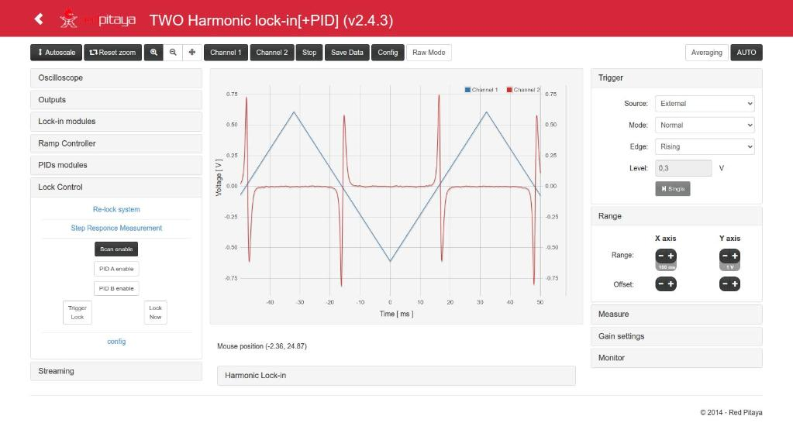

- **Top toolbar**: zoom and acquisition buttons.
- **Left column**: the instruments (Oscilloscope, Outputs, Lock-in modules, Ramp Controller, PIDs modules,
  Lock Control, Streaming). Each title opens or closes its panel.
- **Centre**: the plot (two Y axes, Channel 1 blue and Channel 2 red), the mouse position, and the
  *Harmonic Lock-in* display (X, Y, R, φ of lock-in A and X2, Y2, R2, φ2 of lock-in B).
- **Right column**: the original scope controls (Trigger, Range, Measure, Gain settings) and the Monitor.

Every change is sent to the board when the field loses focus or Enter is pressed (Escape cancels the edit).
Only changed values are sent. A field left empty or with an invalid text is **not** sent: the last value comes
back.

## Panels

### Toolbar

| Button | Action |
|---|---|
| Autoscale | Rescales the **Y axis** to the data on screen, only in the page. Does not end a lock capture. |
| Reset zoom, zoom in/out, pan | Plot navigation. A zoom selects the time window of the acquisition (the decimation is chosen from it). Reset zoom (v2.4.7) sets the window from t = 0 to one period of the ramp (Ext Trig = Scan floor / Scan ceil), one period of the modulation (Ext Trig = harmonic mod., 2520·(hp+1) ticks, the same for both lock-ins) or one whole memory at the current decimation (otherwise), and Y to −1 … 1 V (raw mode −8192 … 8192). Periods of 1.5 s or more: 0.98 × the period, so that every scan is acquired. During a lock capture it first ends it, as AUTO, and uses the restored Ext Trig. The Raw Mode button rescales Y the same way. |
| Mouse wheel on the plot (v2.4.7) | Zoom centred on the mouse, 1.5× per step. **No key:** both axes (time and the two Y axes). **SHIFT** held: time axis only (the cursor becomes a horizontal double arrow ↔). **ALT** held: Y axes only (vertical double arrow ↕; in raw mode the Y range is in counts). The time window is sent to the controller once the wheel stops (250 ms), which chooses the decimation as for any zoom; it stays between 20 ns and 68.7 s. The Y zoom is only in the page (1/2048 … 1000 × full scale). During a lock capture the wheel zoom is only in the page; ending the capture restores the window saved before it. The wheel on the number fields is not affected (SHIFT ×10, CTRL ×100). |
| Channel 1 / Channel 2 | Show or hide each channel. |
| Stop | Stops the acquisition. |
| Save Data | Plot data as Python/Numpy, Matlab/Octave or CSV ([Saving data](#saving-data)). |
| Config | Save / load configurations ([below](#saving-and-loading-configurations)). |
| Raw Mode | Values in counts (`int`) instead of volts. |
| Averaging | Average inside the decimation. |
| **AUTO** | Auto-set of the scope in the controller (time range, trigger, Y range). Ends a lock capture. Not the same as *Autoscale*. |

### Oscilloscope and Outputs

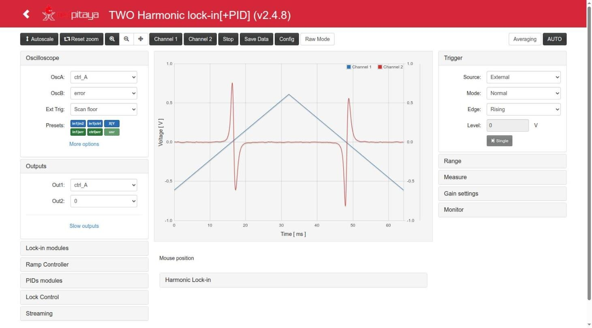

- **OscA / OscB**: signal shown on Channel 1 / Channel 2, any of 25 internal signals: 0, in1, in2, error,
  ctrl_A, ctrl_B, Ramp A/B, pidA/B_in, PID A/B out, **cos_ref, cos_A, sin_A, cos_B, sin_B**, Xo, Yo,
  **X2o, Y2o**, signal_i, **signal2_i**, out1, out2. `sin_ref` is not in this list: use `sin_A` with Phase A = 0.
- **Ext Trig**: event used when the scope trigger *Source* is *External*: None, Pin (DIO0_P), Scan floor,
  Scan ceil, harmonic mod. (start of each period of `cos_ref`), Out of lock, Jump trigger, Lock control trig
  (the lock event; used by Capture Lock). *Square mod.* is not implemented (always 0 in the FPGA) and is not in the
  menu since v2.4.7.
- **More options**: *R|Phase Mode* (disabled) and *Disable anti-aliasing filter* for each channel.

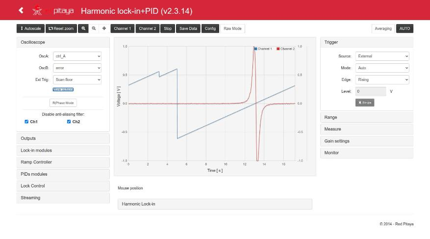

- **Out1 / Out2**: signal sent to each fast output (±1 V): 0, in1, in2, in1−in2, error, cos_ref, PID A out,
  PID B out, ctrl_A, ctrl_B, aux_A, aux_B (cos_1f, cos_2f, cos_3f and sin_ref are "(n/a)"). For a lock,
  Out1 = ctrl_A (ramp + PID A) is the usual choice.
- **Slow outputs**: four selectors. **They have no effect in this version** (the slow outputs are not
  driven by the FPGA, see [App.md](App.md#inputs-and-outputs)).

### Lock-in modules

The panel of the two lock-ins (v2.4.4, defaults). Lock-in A on the tab **LI A**:

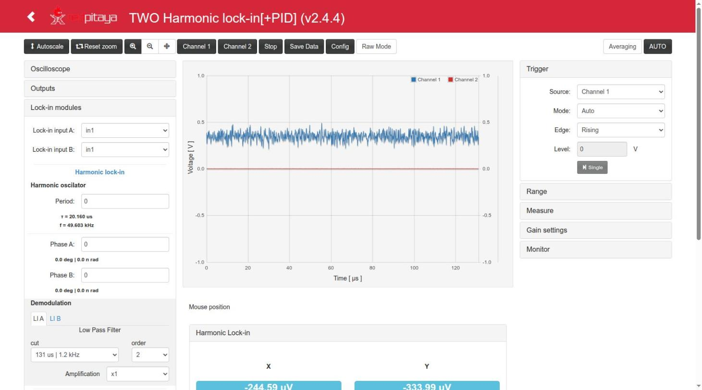

- **Lock-in input A** (`signal_sw`) and **Lock-in input B** (`signal2_sw`): signal demodulated by each lock-in:
  in1, in2, in1−in2, cos_ref, aux_A, Ramp A (sin_ref and cos_1f are "(n/a)"). Both can take the same signal.
- **Harmonic lock-in → Harmonic oscillator**: *Period* (`gen_mod_hp`; τ and f below: 0 → 49.603 kHz), and
  **Phase A** / **Phase B** (`gen_mod_phase_A` / `_B`, 0..2519 = 0..360°, shown in degrees and π rad below):
  the delay of the references of each lock-in with respect to `cos_ref`, the signal added to the outputs.
- **Demodulation**: tabs **LI A** (filter `lpf_F0` and gain `sg_amp0` of X, Y) and **LI B** (filter `lpf_F1`,
  gain `sg_amp1` of X2, Y2). Each with its low-pass filter (*cut* = τ | f, *order* OFF/1/2) and *Amplification*
  (×2ⁿ: up to ×512k for A, ×512 for B).
- **Auxiliar**: *Aux A*, *Aux B* constants, and **Modulation Amplitude** *A Out1* / *A Out2*: amplitude of
  `cos_ref` added to OUT1 / OUT2 (both get `cos_ref` in this App); −1 = off, 0..8191 (≈ value/16384 V).

Tab **LI B**, with the *Harmonic Lock-in* display open below the plot. Both lock-ins demodulate `in1` (noise
only, no modulation) with the same phase, filter and gain, so X = X2 and Y = Y2:

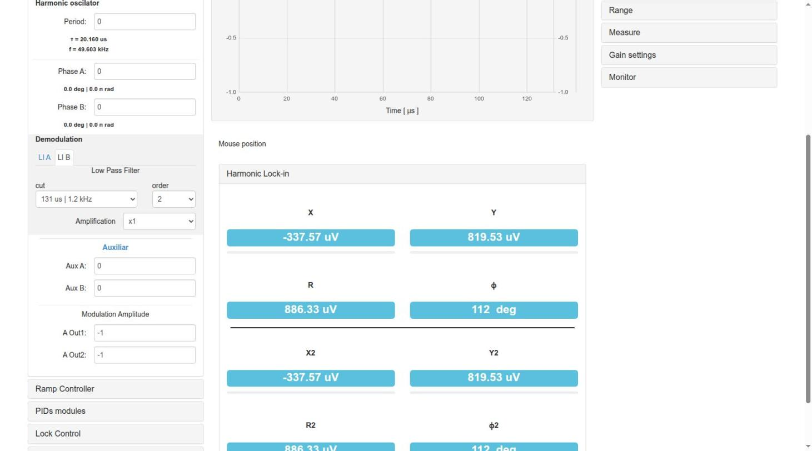

### Ramp Controller

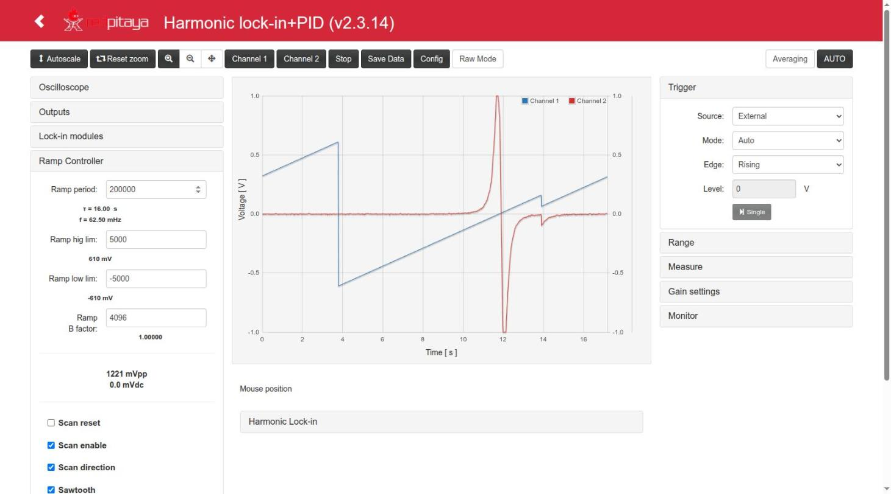

- **Ramp period** (`ramp_step`: ticks per step − 1; below, the resulting period τ and frequency f),
  **Ramp hig lim**, **Ramp low lim** (in counts, with the value in mV below), **Ramp B factor**
  (4096 = 1: ratio of Ramp B to Ramp A). The amplitude (mVpp) and centre (mVdc) are shown below.
- **Scan reset** (hold at 0), **Scan enable** (the ramp runs; the *Scan enable* button of Lock Control
  must also be on), **Scan direction**, **Sawtooth** (otherwise triangle).

### PIDs modules

- **Error signal selector**: *Error signal* (0, Xo, Yo, **X2o, Y2o**, in1, in1−in2; F3o is "(n/a)") and its
  *offset*.
- **PID A / PID B**: *input* (error by default; also Xo, Yo, X2o, Y2o, signal_i, signal2_i, in1−in2, in1, in2,
  aux_A, aux_B, cos_ref, 0), *reset integral*, *freeze out*, *freeze integral*, and the gains *kp*, *ki*, *kd*
  with the effective value written below (kp as a factor, ki and kd as τ and f).
- **More Options** shows the set point *sp*, the scale selectors of kp (/1../4096), ki (8 ns..9 s) and kd
  (7.5 ns..491.5 µs), and *SAT lim* (saturation of the integral term, ±122 µV..±1 V):

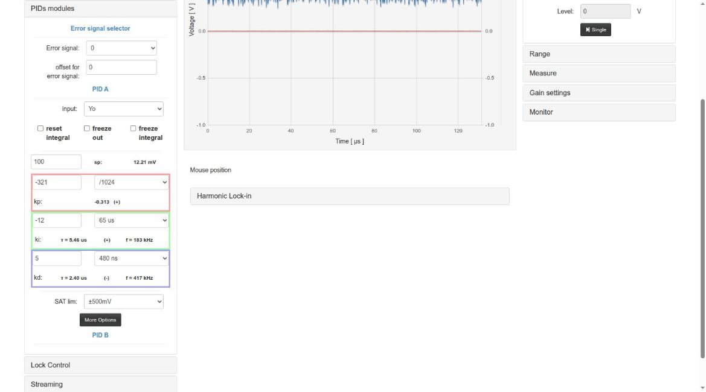

In the example kp = −500 with /1024 gives −0.488, and ki = −20 with 537 ms gives τ = 26.8 ms.

### Lock Control

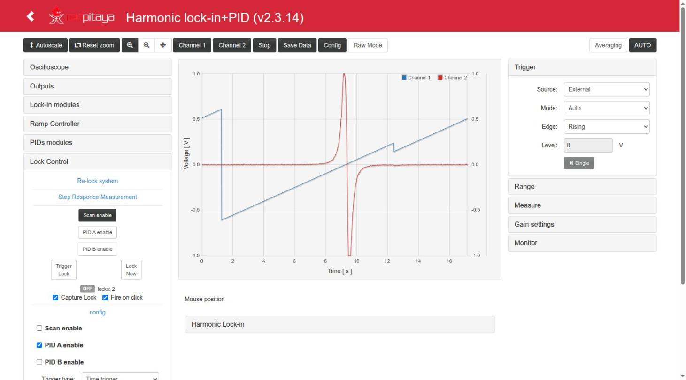

The main part of the panel (from top to bottom):

- **Scan enable / PID A enable / PID B enable**: buttons with the **effective** state of the ramp and the
  PIDs (dark = on). When nothing is locked a click toggles the manual enable; while LOCKED a click
  releases the lock keeping the other enables.
- **Trigger Lock**: arms the lock; it closes when the trigger of the *config* section happens (time,
  level or level+time). **Lock Now**: closes the lock at once. Both stay pressed while requested; a second
  click releases the lock.
- **State label**: OFF / ARMED / LOCKED and the number of locks since the FPGA was loaded.
- **Capture Lock** (on by default): every lock request from the page captures the closing of the loop in
  the scope and freezes the trace. **Fire on click** (on by default): with *Choose from graph*, a click on
  the plot sets the trigger value and fires *Trigger Lock*. Design: [`lock_capture.md`](../lock_in+pid_harmonic2/doc/lock_capture.md).
- **config** (open it with its title):

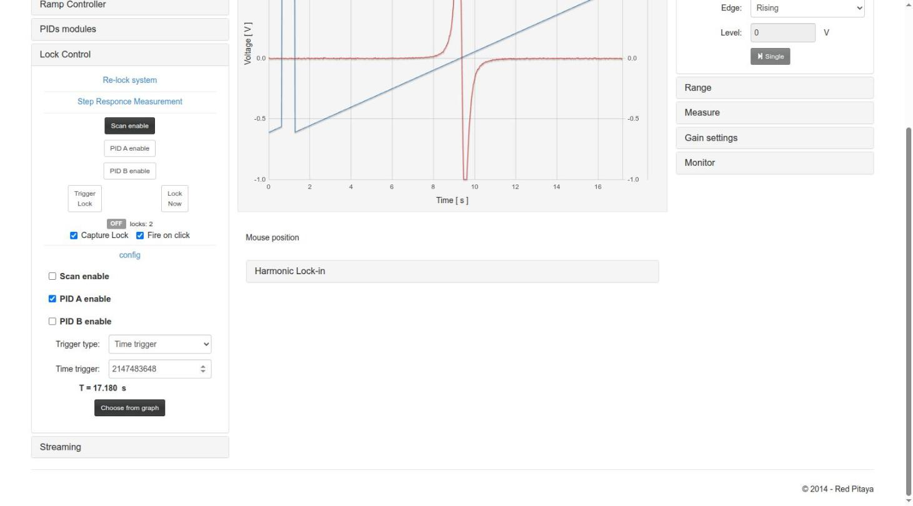

  - *Scan enable*, *PID A enable*, *PID B enable*: what is on **while LOCKED** (usually: scan off, PID A on).
  - *Trigger type*: OFF (only Lock Now), Time trigger, Level Trigger, Level+time Trigger.
  - *Time trigger*: delay after the scan floor, in ticks of 8 ns or with units (`16.58 ms`, `20 s`; see
    [below](#typing-values-with-units)); shown as T below. 0 = OFF, up to 4294967295 = 34.36 s.
  - *Signal for trigger* (error, Xo, Yo, X2o, Y2o, signal_i, Ramp A, aux_A, in1, in2, in1−in2, PID A out),
    *Level trigger* (counts or `V`/`mV`, shown in mV below), *trig upward?*: for the level trigger.
  - **Choose from graph**: the next click on the plot sets the time (Time trigger) or the level (Level trigger).
    A second click on the button (*Cancel*) or Esc cancels it. A red warning appears if the scope is not in
    Normal/Single + External + Scan floor (the only setup where t = 0 of the plot is the scan floor).

- **Re-lock system** and **Step Responce Measurement** (open them with their titles):

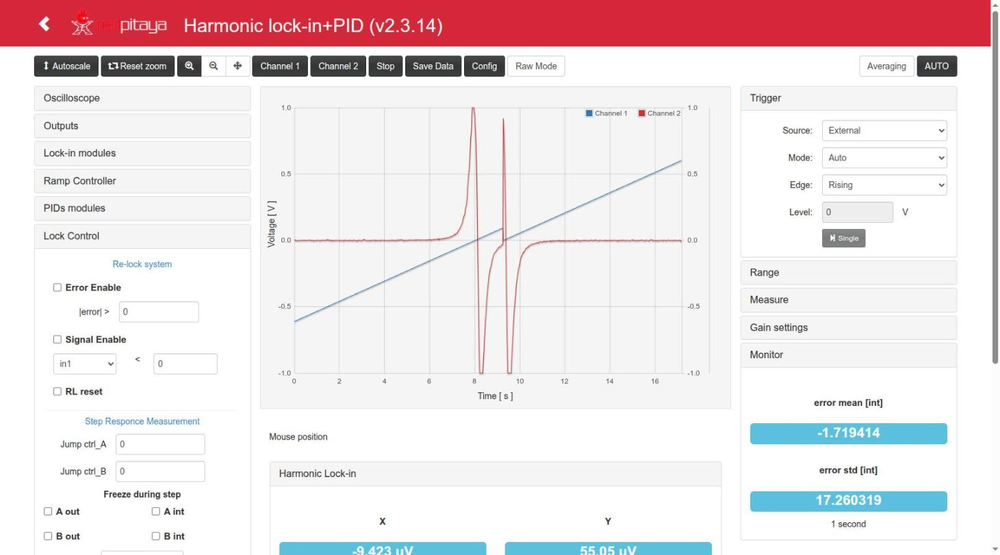

  - Re-lock: *Error Enable* with `|error| >` threshold, *Signal Enable* with a signal `<` threshold,
    *RL reset*. Not tested on this version (see [App.md](App.md#re-lock-and-step-response)).
  - Step response: *Jump ctrl_A*, *Jump ctrl_B*, *Freeze during step* (A/B out, A/B int), *Start Step Responce*.

How the lock control works inside: [`lock_control.md`](../lock_in+pid_harmonic2/doc/lock_control.md).

### Streaming

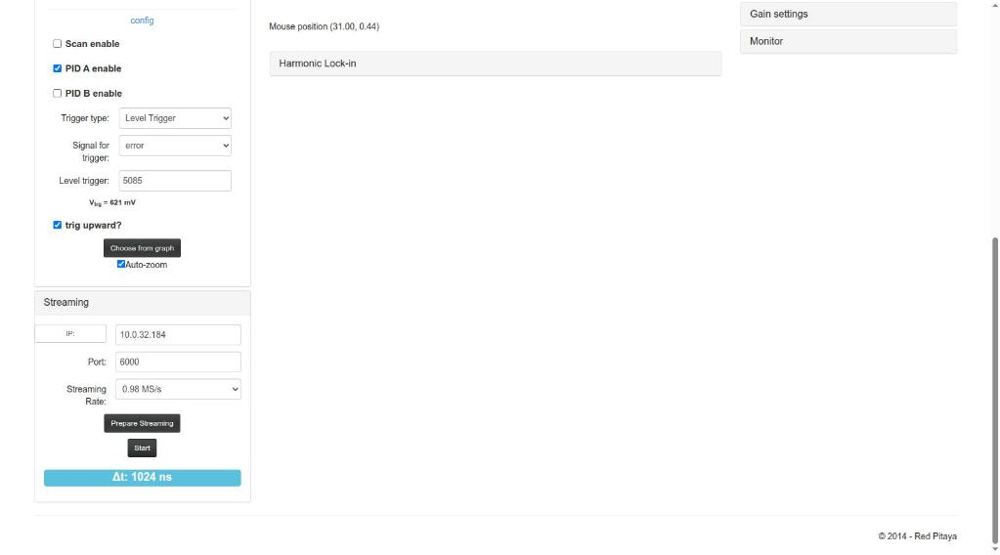

- **IP** (the *IP* button fills in the address of the computer running the browser), **Port** (6000 for
  the server of `resources/streaming`), **Streaming Rate** (1.95 MS/s .. 1.9 kS/s; 0.98 MS/s is the fastest
  continuous rate); Δt below.
- **Prepare Streaming** starts `c/streaming` on the board and leaves the scope of the page in Single (the page
  stops polling); **Start** / **Stop** send the data.
- Start the receiver on the computer first (`resources/streaming/server`, or `nc -l <port>`); details in
  `resources/README.md`. Avoid opening `ssh` sessions on the board while streaming at 0.98 MS/s
  ([App.md](App.md#streaming)).

### Right panels and displays

- **Trigger**: *Source* (Channel 1, Channel 2, External), *Mode* (Auto, Normal, Single), *Edge*, *Level*,
  and the *Single* button. External uses the *Ext Trig* of the Oscilloscope panel.
- **Range**: buttons for the X and Y scales and offsets.
- **Measure**: min, max, amplitude, average, frequency and period of each channel.
- **Gain settings**: probe attenuation (1x/10x) and LV/HV jumper setting of each input (scale of the display).
- **Harmonic Lock-in** (below the plot, see the LI B screenshot above): X, Y, R, φ (lock-in A) and X2, Y2, R2, φ2
  (lock-in B) in volts, computed from the 28-bit registers (`X_28/2047/8191`; in Raw mode in counts of the
  14-bit outputs at gain ×1).
- **Monitor**: mean and standard deviation of the error over ~1 s, in counts.

## Options shown as "(n/a)"

The FPGA of this App has no `sin_ref`, `cos_1f`, `cos_2f`, `cos_3f` nor `F3o` (they are 0). The selectors keep
those values, so that indices and saved configs stay the same as in `_h`, but show them disabled with
"(n/a)" (Out1/Out2, lock-in inputs, error, PID inputs, slow outputs 3-4):

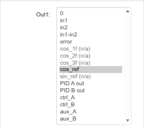

A config that selects one of them is loaded anyway (the output is 0) and a warning is written in the browser
console (`warnNaSwitches()`, `index.html` l. 3852). The *Signal for trigger* list of Lock Control does not mark
them (5 "F3o" and 6-8 with code text are 0).

## Typing values with units

The **Time trigger** and **Level trigger** fields of *Lock Control → config* are text fields that accept a number
with a unit (`index.html` l. 2271-2285, `parseTrigTime()`, `parseTrigLevel()`):

| Field | Without unit | Units | Range | Examples (tested on the board, v2.4.4) |
|---|---|---|---|---|
| Time trigger | ticks of 8 ns | `s` (`seg`), `ms`, `us` (`µs`), `ns`, `tick(s)` | 0 .. 4294967295 (34.36 s); larger values are clamped | `16.58 ms` → 2072500, `20 s` → 2500000000, `40 s` → 4294967295 (T = 34.360 s) |
| Level trigger | counts | `V`, `mV`, `count(s)` | −8192 .. 8191 (clamped) | `0.1 V` → 819, `120 mV` → 983 |

- Decimal point or comma; the space between number and unit is optional; units are not case sensitive.
- The value is sent when the edit ends (Enter or leaving the field, 1 POST); then the field is rewritten in
  ticks / counts. Escape restores the previous value.
- An empty or invalid text (`abc`) is not sent: the last value comes back (0 POST on the board). The mouse
  wheel changes the value by one tick / count.
- Values above 2²⁴ ticks (134 ms) go through the float parameters of the C controller and are rounded to a
  multiple of 2 to 256 ticks ([FPGA.md](FPGA.md#lock-control-auto-lock)).

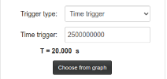

Other fields have older unit conversions in the JavaScript, but they are `<input type="number">` fields, where
browsers do not let letters be typed: **a confirmar** whether they can be used from the UI. Those conversions
are: ramp limits and PID sp (`V`, `mV`), ramp period (`s`, `ms`), period of the oscillator (`s`, `ms`, `us`) and
**Phase A / Phase B** (`deg`, `rad`, `pi`; `index.html` l. 2150-2180).

## Procedures

These procedures follow `test_files/lock_test.md`, the procedure used to test every version on the board,
with the configuration `test_files/lock_in+pid_harmonic2__lock_mode.json` (the LOCK MODE config of `_h` with
Phase A = 0, Phase B = 630 and Lock-in input B = in1): a system with a resonance (a peak, made by
`dummy_simulator` on a second board) whose control input is OUT1 and whose response is measured on IN1.

### 1. Scan and see the response of the system

1. **Outputs**: Out1 = `ctrl_A`.
2. **Ramp Controller**: limits ±5000 (±610 mV), period 400 (triangle: 64.16 ms), *Scan enable* checked.
3. **Lock Control**: *Scan enable* button on, *PID A enable* off.
4. **Oscilloscope**: OscA = `Ramp A` (or `ctrl_A`), OscB = `in1`; Ext Trig = *Scan floor*.
5. **Trigger**: Source *External*, Mode *Normal*. Zoom to one period of the ramp: t = 0 is the scan floor.

The response of the system (the peak) appears on Channel 2 at the same position in every sweep.

### 2. Configure the lock-ins to get an error signal

The lock-in, with a small modulation added to the control signal, gives a signal proportional to the
derivative of the response with respect to the scan: it crosses zero at the maximum of the peak, which is
the error signal for the PID.

1. **Lock-in modules**: Lock-in input A = `in1`; Period = 0 (49.6 kHz); *A Out1* = 100 (modulation of ≈ 6 mV
   added to OUT1); tab LI A: filter 262 µs | 607 Hz, order 2, Amplification ×32.
2. Look at `Xo` and `Yo` (OscA/OscB) during the scan: change **Phase A** or choose the component (X or Y)
   that gives a clean dispersive curve with a zero crossing at the peak. The references can be checked on the
   scope (OscA = `cos_ref`, OscB = `cos_A` or `cos_B`):

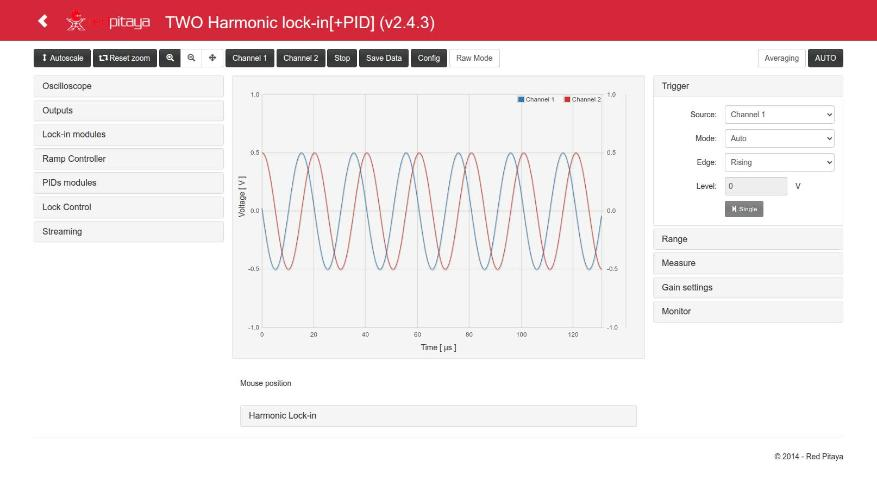

3. Optionally set **lock-in B** for a second error signal or a monitor: Lock-in input B (the same input or
   another detector), **Phase B** (630 = 90° gives the quadrature of lock-in A: X2 = Y, Y2 = −X), tab LI B.
4. **PIDs modules**: Error signal = the chosen component (`Yo` in the test configuration; `X2o`/`Y2o` are also
   possible), offset 0.
5. OscA = `ctrl_A`, OscB = `error`: the error crosses zero at the peak (see the [layout](#layout-of-the-page)
   screenshot).

### 3. Close the lock

1. **PID A**: input = error, kp = −500 (/1024), ki = −20 (537 ms). The sign of the gains has to give
   negative feedback around the zero crossing (try the other sign if the lock runs away).
2. **Lock Control → config**: while locked, *PID A enable* on and *Scan enable* off.
3. Choose the trigger:
   - **Time trigger**: press *Choose from graph* and click on the zero crossing of the error (16.58-16.62 ms in
     the tests). With *Fire on click* on, the click also fires *Trigger Lock*.
   - **Level trigger**: Signal for trigger = error, Level = the value of the error just before the
     crossing (5085 counts = 621 mV in the test), *trig upward?* according to the slope.
   - **Lock Now**: locks immediately wherever the ramp is (useful only when the system is already near the
     point).
4. Press **Trigger Lock**. The state goes OFF → ARMED → LOCKED in the next sweep (≤ 49 ms in the tests); with
   *Capture Lock* the scope shows the closing of the loop (t = 0 is the lock) and keeps it frozen. With
   *Fire on click*, one click on the plot sets T and locks:

The whole sequence (Choose from graph, Trigger Lock, Auto, X2/Y2, release, Level trigger, Scan enable / Lock
Now, Capture + Fire on click, AUTO), recorded by testAgent on v2.4.4:

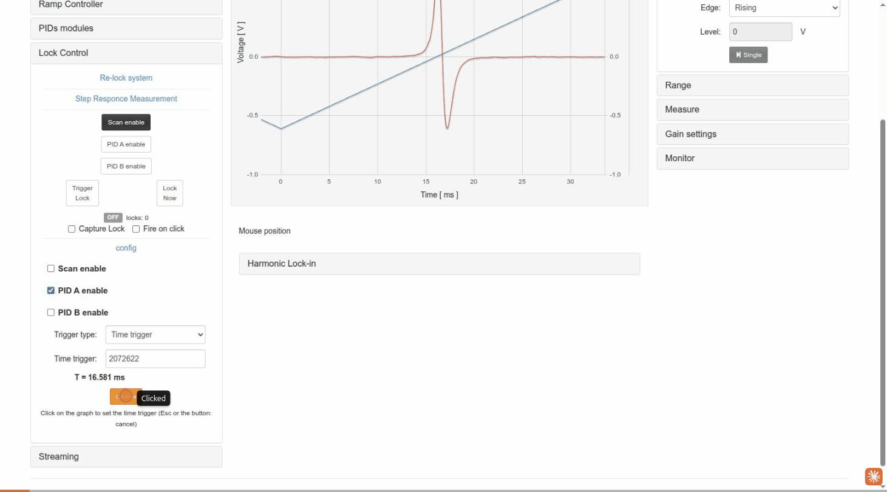

If *Choose from graph* shows the red warning, t = 0 of the plot is not the scan floor and the time taken
from the click would be wrong:

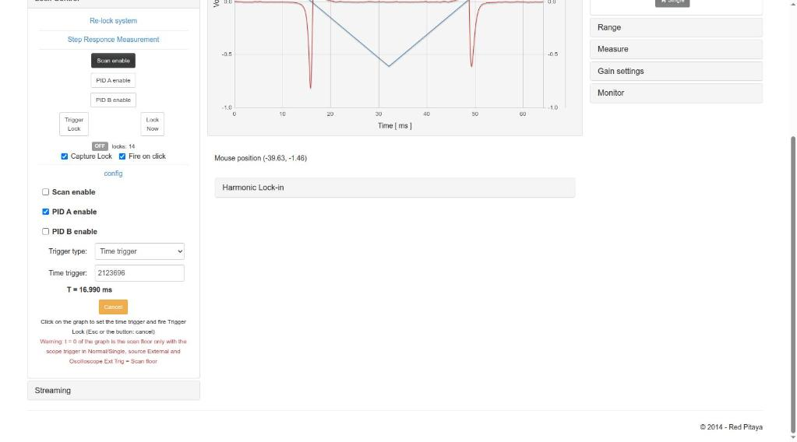

The frozen capture ends (and the scope settings saved before the capture are restored) with trigger mode
Auto/Normal, *Single*, **AUTO**, a change of source or Ext Trig, unchecking *Capture Lock*, or a release
while waiting. *Autoscale* keeps it.

### 4. Check the lock and release it

1. Set the trigger Mode to **Auto**: the ramp has stopped and the error stays at 0 (OscA = `ctrl_A`,
   OscB = `error`):

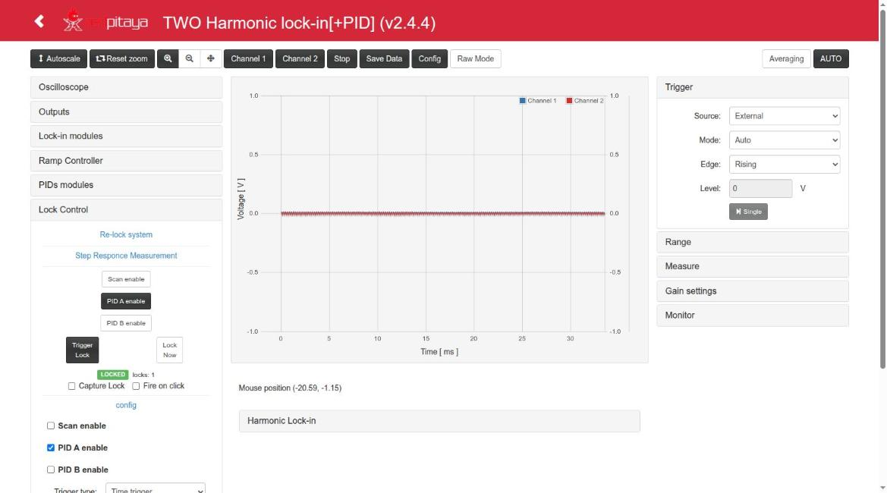

2. With OscA = `in1` the signal stays at the top of the peak (0.444-0.448 V in the tests, 1.02 × the peak):

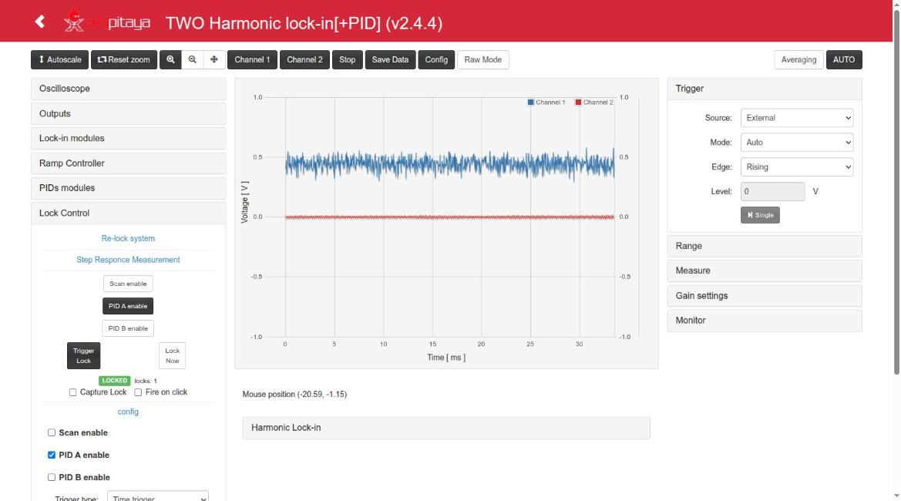

3. The **Monitor** panel shows the mean (≈ 0) and the std of the error (≈ 63 counts ≈ 7.7 mV in the tests).
4. **Release**: a second click on *Trigger Lock* (or *Lock Now*), or a click on *Scan enable* (restarts the
   scan with the PIDs as they were).

A lock can also be closed and checked without the web page, with `py/lock_from_registers.py` on the board
or over HTTP (see [Remote.md](Remote.md)); the page follows the state (OFF/ARMED/LOCKED, Time trigger field,
Trigger type) without sending anything (0 POST, seen on the board).

### 5. Use the second lock-in while locked

Lock-in B keeps working with the loop closed and does not disturb it. In the test, with the lock on `Yo`:
Lock-in input B = in1 and Phase B = 630 gave `Y2o ≈ −Xo/32` (B at ×1, A at ×32); with Lock-in input B =
`cos_ref`, X2o = 0 and Y2o = −0.4999 V, and the label stayed LOCKED:

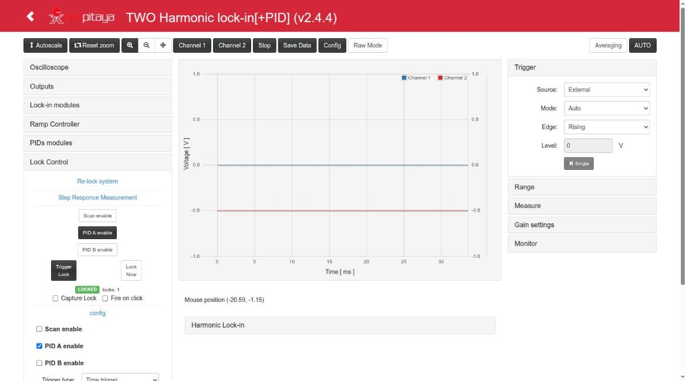

## Saving and loading configurations

**Config** opens the configuration dialog:

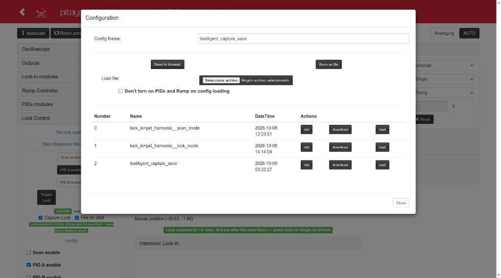

- *Save in browser* stores all the parameters (and the Capture Lock / Fire on click preferences) under the
  *Config Name* in the browser (`localStorage`, key `lockConfig_lock_in+pid_harmonic2`). *Save as file*
  downloads a JSON.
- The list shows the saved configs with *del*, *download* and *load*. *Load file* adds a JSON file to the list
  (then press its *load*).
- **Don't turn on PIDs and Ramp on config loading**: when checked, a loaded config never turns on the
  ramp, the PIDs or a lock request (safe default when the outputs are connected to an experiment).
- Configs are per browser, not stored on the board. Configs of `lock_in+pid_harmonic` can be loaded (missing
  keys keep their current value: Phase B, Lock-in input B), but `lock_gen_mod_phase` of `_h` is not
  `lock_gen_mod_phase_A`.
- **Time window**: *load* applies the time window of the config in the units it was saved with. Tested on the
  board (v2.4.4): 8/8 loads of `lock_mode` (saved in ms) from windows in µs and ms → always −2.07…33.49 ms
  (in v2.4.3 one of three loads left the window in µs with the numbers of ms).
- A load ends a frozen lock capture (the config brings its own scope settings).

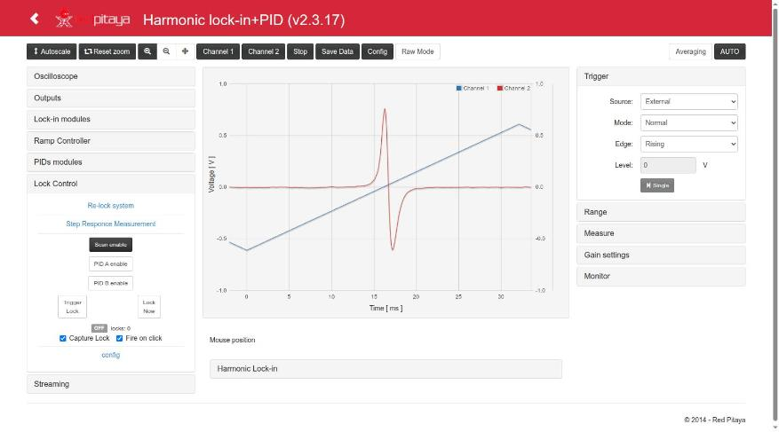

## Saving data

*Save Data* gives the data of the plot as Python/Numpy vectors, Matlab/Octave vectors or CSV (save as a
file, copy or show).

## Several clients, Restart and errors

Only one browser tab should control the board. When another client (another tab, the main menu, another
App) takes the board, the page stops polling and shows a dialog:

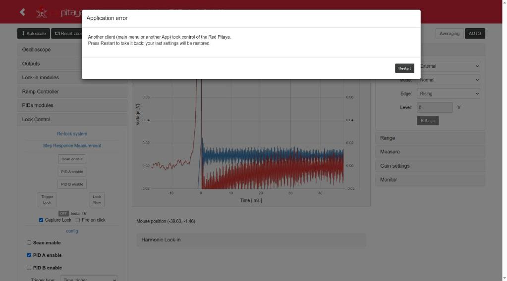

*Restart* restarts the App and restores the state of this tab (if the other client loaded the same App,
the FPGA is not reloaded). On Ecosystem 2.0 the page also enters a "cautious mode" when the board answers
slowly (`/get_client_id` slow twice in a row) and waits until it answers fast again; after 10 checks without
leaving it a dialog offers Retry / Restart:

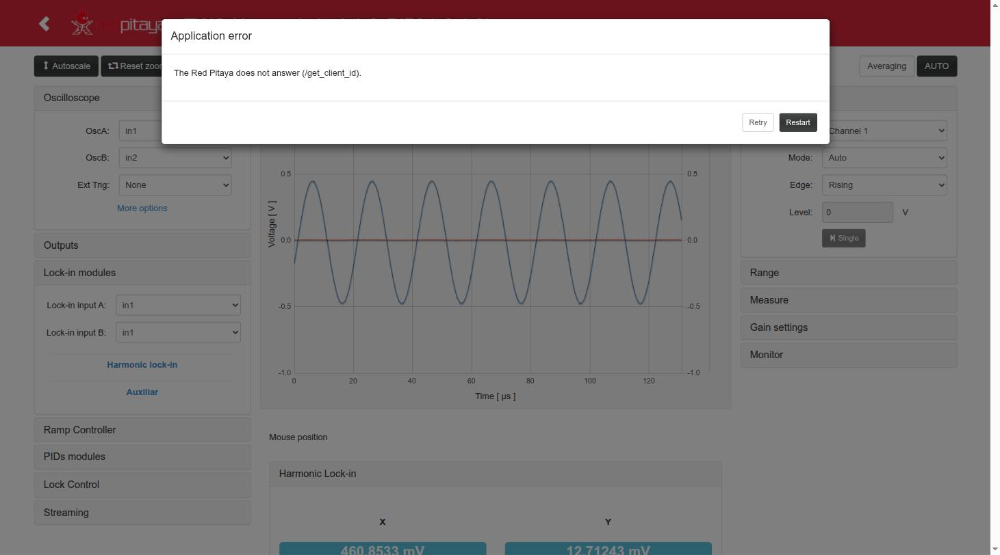

Specific of this App: a failed `GET /data` is retried and the error dialog appears only after 3 consecutive
failures; a failed `POST /data` chunk (E3) is shown as a toast ("The sent params were PROBABLY not applied")
instead of a dialog.

After *Prepare Streaming* the page is in Single and does not poll, so a stop of the App made from outside is not
noticed until something is touched; then "Application not loaded" appears and *Restart* restores the state
(including the streaming IP):

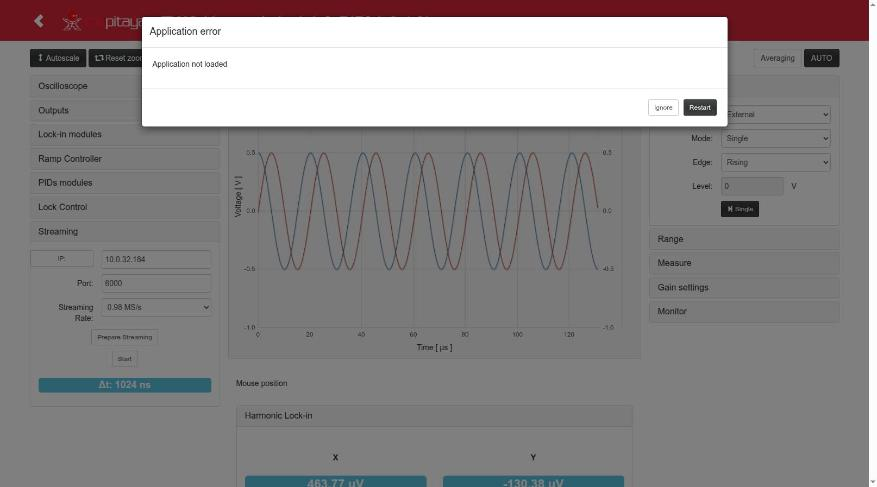

## Known limitations of the interface

- The **Slow outputs** selectors have no effect; the **R|Phase Mode** button is disabled.
- *Time trigger* values above 2²⁴ ticks (134 ms) set from the page are rounded to the float32 grid (≤ 1 µs).
- *Ramp period* typed in `s`/`ms` sets `ramp_step` for (hig − low) steps, i.e. half of the period in
  triangle mode (`index.html` l. 1855-1858): check the τ shown below the field.
- *Signal for trigger* 5 is "F3o" (0) without "(n/a)" and 6-8 show code text (`/*sqXo */ 14'b0`): those options
  are 0.
- Each change made in the page is a `POST /data`, and on Ecosystem 2.0 each one leaves an open connection in the
  nginx of the board; after ~1000 the board stops answering until nginx is restarted
  ([Remote.md](Remote.md#known-issue-of-the-ecosystem-post-data-leaves-connections-open)).
- Config → load also sends read-only parameters (`meas_*`, `lock_X`, `lock_Y`, `lock_X2`, `lock_Y2`,
  `lock_lock_status`, `lock_lock_control`; 206 keys per load, seen by testAgent): the controller ignores them,
  they only make the load longer.
- After *Prepare Streaming* the page does not detect an external stop of the App (above).
- Console message "Capture Lock: ended by , scope settings restored" (empty reason) when a capture ends with
  AUTO (cosmetic).
- Level+time with the time after the level crossing stays ARMED (the level crossing has to happen after
  the time).

These items are listed for devAgent in `docAgent.md`.
